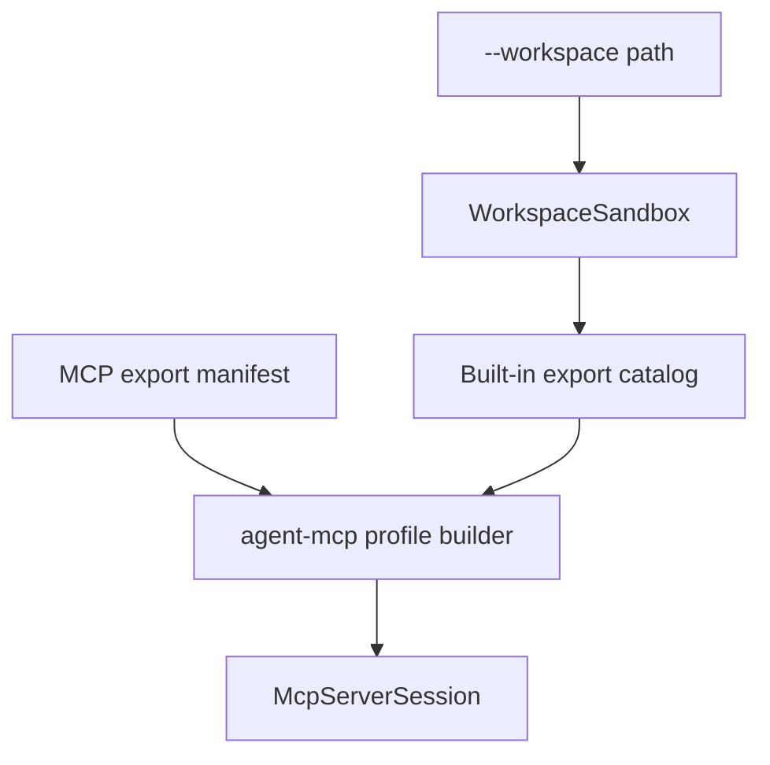

# M33-00 MCP Built-in Tool Export Technical Design Spec

## Purpose

Define the architecture for exposing a curated built-in tool catalog through MCP server export profiles.

## Product Context

M32 added explicit profile manifests. M33 makes tool declarations operational for safe built-in workspace inspection tools, supporting MCP server export without arbitrary code loading or UI-specific runtime logic.

## Scope

This spec delivers:

- built-in export allow-list and excluded tool classes
- workspace sandbox requirement for built-in tools
- manifest binding flow from profile to catalog to MCP server session
- CLI stdio profile startup shape
- trace, privacy, and verification rules

Owned by other specs:

- plugin-provided export catalogs
- side-effecting tool export
- Desktop MCP server management

## Architecture

`agent-mcp` is the boundary between export manifests and MCP server profiles. It may create an export catalog from `agent-tool` built-ins and an `agent-sandbox::WorkspaceSandbox`. `agent-cli` passes an explicit workspace path into that runtime helper.



## File Layout

```text
crates/
  agent-mcp/src/
    server_manifest.rs
    server_profile.rs
  agent-cli/src/
    command.rs
docs/
  specs/M33-*.spec.md
  plans/M33-*.plan.md
```

## Public Contracts

```rust
pub struct McpServerBuiltinToolExportCatalogConfig {
    pub workspace_root: PathBuf,
}

pub fn build_mcp_server_builtin_tool_export_catalog(
    config: McpServerBuiltinToolExportCatalogConfig,
) -> Result<McpServerToolExportCatalog, McpError>;
```

The initial built-in allow-list is:

- `workspace.read_file`
- `workspace.search_text`
- `workspace.git_status`
- `workspace.git_diff`

Excluded from M33:

- `workspace.shell_command`
- `workspace.edit_file`

## State and Failure Handling

- Catalog construction validates the workspace root once, before profile binding.
- Unknown or excluded manifest tool names fail before stdio protocol output.
- Catalog helper returns stable tool names for diagnostics and tests.
- Existing resource manifest loading remains independent from workspace root.

## Security and Privacy

- The catalog is an allow-list, not reflection over every registered built-in.
- Workspace sandbox validation is mandatory for built-in tool exports.
- Tool results are not emitted in startup diagnostics.
- Policy checks remain mandatory for `tools/call`.

## Testing Strategy

- Catalog tests assert allow-list contents and excluded tools.
- Manifest tests assert allowed, unknown, duplicate, and disabled cases.
- CLI tests assert workspace-required behavior only when tools are declared.
- Protocol tests assert list/call behavior.

## Acceptance Criteria

- The design enables M33-01 through M33-05 without changing MCP protocol contracts.
- Side-effecting tools remain unavailable through the default built-in catalog.
- Resource-only profiles keep M32 behavior.

## Completion Signal

This technical design is complete when all M33 slice specs/plans exist and `docs/milestones/README.md` points to M33-01 as the next implementation slice.
