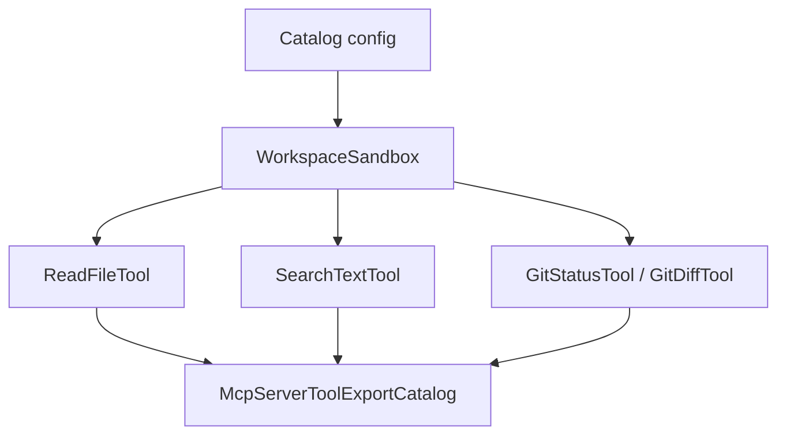

# M33-01 Built-in Tool Export Catalog Spec

## Purpose

Create the explicit built-in tool export catalog used by MCP server profiles.

## Product Context

Users should be able to expose safe local workspace inspection tools to MCP clients without granting arbitrary shell, edit, plugin, or process capabilities.

## Scope

This spec delivers:

- catalog construction from a validated workspace root
- registration of read/search/git inspection tools
- explicit exclusion of shell and edit tools
- stable catalog names for diagnostics

Owned by other specs:

- CLI argument parsing
- JSON-RPC stdio tool call e2e

## Architecture

`agent-mcp` owns `McpServerToolExportCatalog`; this slice adds a helper that registers selected `agent-tool` built-ins with `WorkspaceSandbox`.



## File Layout

```text
crates/agent-mcp/src/server_manifest.rs
crates/agent-mcp/src/lib.rs
crates/agent-mcp/tests/mcp_server_builtin_tool_catalog.rs
```

## Public Contracts

```rust
pub struct McpServerBuiltinToolExportCatalogConfig {
    pub workspace_root: PathBuf,
}

impl McpServerBuiltinToolExportCatalogConfig {
    pub fn new(workspace_root: impl Into<PathBuf>) -> Self;
}

pub fn build_mcp_server_builtin_tool_export_catalog(
    config: McpServerBuiltinToolExportCatalogConfig,
) -> Result<McpServerToolExportCatalog, McpError>;
```

## State and Failure Handling

- Invalid workspace roots return `McpError::InvalidServerRequest`.
- Duplicate static tool registration fails through the existing catalog duplicate path.
- Catalog `tool_names()` returns deterministic sorted names.

## Security and Privacy

- Only allow-listed tools are registered.
- The helper never reads workspace files during startup.
- Workspace path diagnostics are redacted with existing MCP redaction helpers.

## Testing Strategy

- Assert expected names are present.
- Assert shell/edit names are absent.
- Assert invalid workspace root returns a safe error.
- Assert helper output can bind an allowed manifest tool.

## Acceptance Criteria

- `CARGO_TARGET_DIR=target/codex-m33 cargo test -p agent-mcp mcp_server_builtin_tool_catalog`
- No side-effecting built-ins are available from the helper.

## Completion Signal

M33-01 is complete when the catalog helper is public, tested, and exported from `agent-mcp`.
