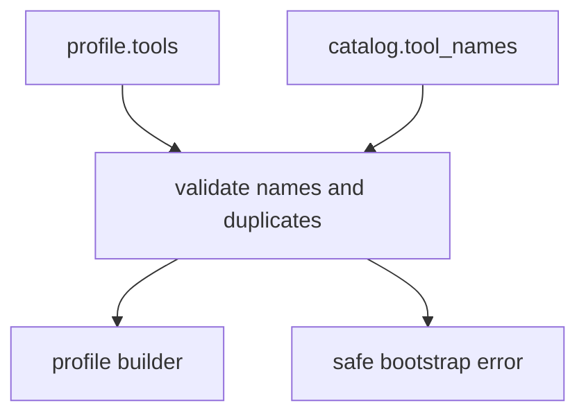

# M33-02 Manifest Tool Binding Diagnostics Spec

## Purpose

Harden manifest-to-catalog tool binding so profile startup errors are actionable, deterministic, and safe.

## Product Context

When users edit an MCP export manifest, they need to know whether a tool name is selectable, disabled, duplicated, or unavailable without seeing raw tool inputs, resource contents, or secrets.

## Scope

This spec delivers:

- safe diagnostics for unknown or excluded tool names
- duplicate manifest tool detection
- tests for disabled tool visibility and call rejection
- stable catalog name reporting for troubleshooting

Owned by other specs:

- actual CLI workspace flag
- protocol e2e calls

## Architecture

The existing `build_mcp_server_profile_from_manifest` remains the binding point. This slice strengthens validation before profile construction completes.



## File Layout

```text
crates/ruse-mcp/src/server_manifest.rs
crates/ruse-mcp/tests/mcp_server_tool_catalog.rs
crates/ruse-mcp/tests/mcp_server_manifest_tool_diagnostics.rs
```

## Public Contracts

No new protocol contracts are required. The existing `McpServerToolExportCatalog::tool_names()` remains the diagnostic source.

## State and Failure Handling

- Duplicate tool names in one profile fail before builder mutation.
- Unknown names fail with a bounded diagnostic including the unavailable name and known exportable names.
- Disabled tools are registered as disabled exports but do not appear in active profile tool names.

## Security and Privacy

- Diagnostics list tool names only.
- Secret-like tool names remain redacted by existing validation.
- Tool schemas and outputs are not copied into errors.

## Testing Strategy

- duplicate manifest tool test
- unknown name test with known names
- disabled tool list/call behavior through profile/runtime tests
- redaction regression test

## Acceptance Criteria

- `CARGO_TARGET_DIR=target/codex-m33 cargo test -p ruse-mcp mcp_server_manifest_tool_diagnostics`
- Existing M32 manifest and catalog tests still pass.

## Completion Signal

M33-02 is complete when manifest tool binding reports safe, deterministic diagnostics and all ruse-mcp focused tests pass.
