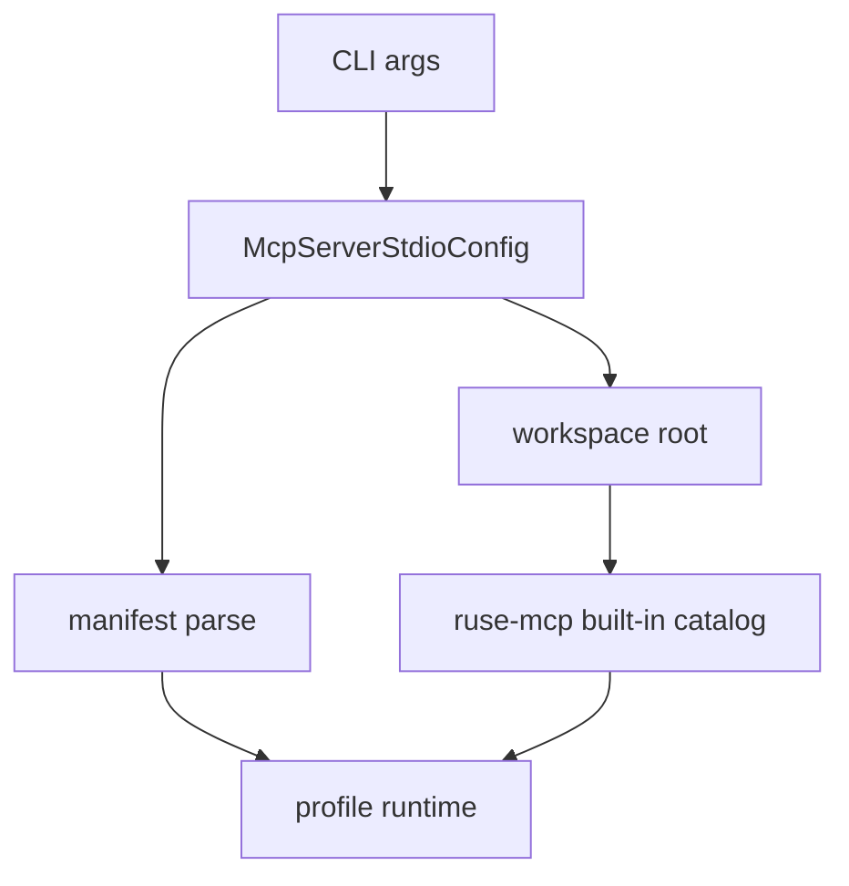

# M33-03 CLI Workspace Tool Profile Spec

## Purpose

Wire the built-in export catalog into `ruse-cli mcp server stdio --profile` using an explicit workspace root.

## Product Context

CLI users should be able to start a local MCP server that exposes profile-declared built-in workspace tools, while scripts and MCP clients keep protocol-only stdout.

## Scope

This spec delivers:

- `--workspace <path>` parsing for `mcp server stdio`
- `McpServerStdioConfig.workspace_root`
- startup preflight that requires workspace only when tools are declared
- safe bootstrap errors for missing or invalid workspace roots

Owned by other specs:

- catalog helper implementation
- protocol-level tool call tests

## Architecture

`ruse-cli` reads the manifest and path flags, then delegates profile construction to `ruse-mcp`. It does not instantiate arbitrary tools outside the curated helper.



## File Layout

```text
crates/ruse-cli/src/command.rs
crates/ruse-cli/tests/mcp_server_profile_command.rs
crates/ruse-cli/tests/mcp_server_workspace_tool_profile.rs
```

## Public Contracts

```bash
ruse-cli mcp server stdio --profile exports.json --workspace .
ruse-cli mcp server stdio --profile exports.json --profile-name default --workspace .
```

`--workspace` is ignored for resource-only startup only in the sense that resource profiles do not require it. If provided, it must still be valid.

## State and Failure Handling

- Profile with tools and no `--workspace` fails before protocol output.
- Profile with resources only works without `--workspace`.
- Invalid workspace path fails before protocol output.
- Existing `--max-frames` and `--profile-name` behavior remains unchanged.

## Security and Privacy

- Workspace root is explicit for tool exports.
- Paths in diagnostics are redacted through existing CLI redaction helpers.
- stdout remains MCP protocol-only.

## Testing Strategy

- parser tests for `--workspace`
- subprocess/stdout tests for missing workspace failure
- resource-only regression test
- invalid path redaction test

## Acceptance Criteria

- `CARGO_TARGET_DIR=target/codex-m33 cargo test -p ruse-cli mcp_server_workspace_tool_profile`
- Existing M32 CLI profile tests continue passing.

## Completion Signal

M33-03 is complete when CLI can bootstrap a manifest tool profile only with a valid explicit workspace root.
