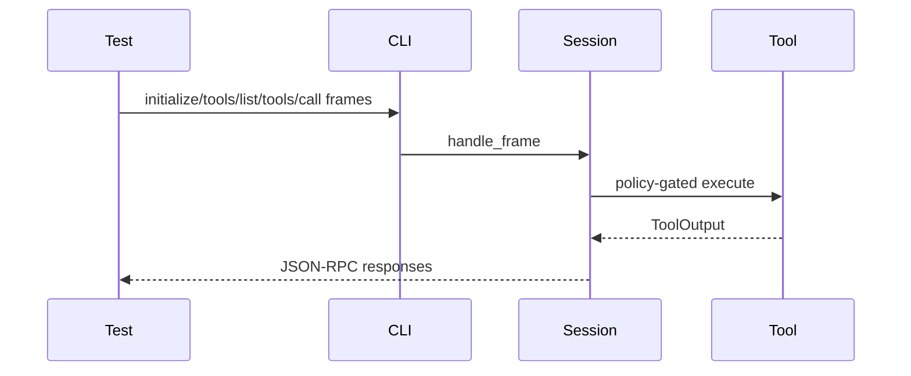

# M33-04 Stdio Tool Call E2E Spec

## Purpose

Prove that an MCP client can list and call a manifest-exported built-in tool over stdio.

## Product Context

M33 is valuable only if the server protocol path works end to end: manifest selection, catalog binding, session initialization, `tools/list`, `tools/call`, policy, tool execution, and redacted trace summaries.

## Scope

This spec delivers:

- stdio fixture test for initialize, tools/list, and tools/call
- read-only workspace fixture with deterministic content
- disabled or unknown tool call regression
- redacted diagnostics and protocol-only stdout assertions

Owned by other specs:

- catalog construction
- CLI argument parsing

## Architecture

The test should use the public CLI stdio IO function where possible, then assert JSON-RPC responses rather than internal structs.



## File Layout

```text
crates/agent-cli/tests/mcp_server_workspace_tool_profile.rs
crates/agent-mcp/tests/mcp_server_builtin_tool_call.rs
```

## Public Contracts

The protocol output must include an MCP `tools/list` entry for `workspace.read_file` and a successful `tools/call` result for a workspace-confined file.

## State and Failure Handling

- Calls before initialization behave according to existing session rules.
- Calls to non-exported tools fail with an MCP error.
- Tool execution errors are represented as safe MCP errors or tool result errors, consistent with existing server behavior.

## Security and Privacy

- Test fixtures must not rely on user files.
- stderr diagnostics are safe; stdout remains JSON-RPC only.
- Tool output appears only as the requested protocol response, not in startup logs.

## Testing Strategy

- CLI IO test with in-memory stdin/stdout
- optional direct `agent-mcp` session test for a built-in catalog
- JSON parsing assertions for response shape and content
- no raw diagnostics on stdout

## Acceptance Criteria

- `CARGO_TARGET_DIR=target/codex-m33 cargo test -p agent-cli mcp_server_workspace_tool_profile`
- `CARGO_TARGET_DIR=target/codex-m33 cargo test -p agent-mcp mcp_server_builtin_tool_call`

## Completion Signal

M33-04 is complete when a manifest-exported built-in read tool is callable over stdio and non-exported calls fail safely.
