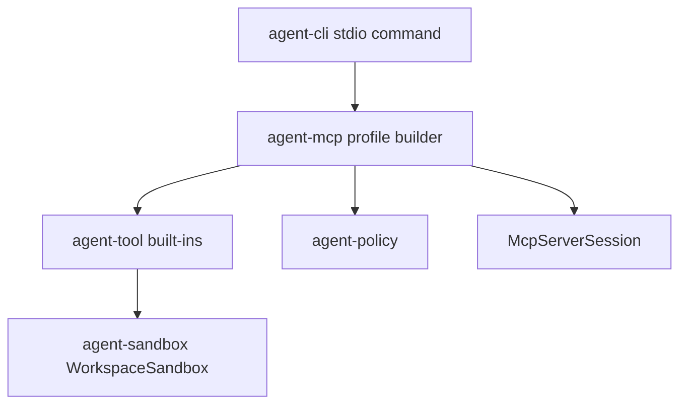

# M33 MCP Built-in Tool Export Runtime Spec

## Purpose

Allow MCP stdio export profiles to expose a small, explicit catalog of built-in workspace inspection tools. M32 lets manifests name tools, but the CLI profile path intentionally provides an empty catalog. M33 closes that gap without widening permissions: only curated built-in read-oriented tools can be selected, every call still flows through MCP export registration, local policy, tool execution, trace summaries, and protocol-safe diagnostics.

## Product Context

This milestone supports the PRD MCP server journey: selected local tools and resources can be exposed through a local MCP server while preserving least privilege, auditability, and CLI/Desktop-neutral runtime contracts.

## Scope

This spec delivers:

- a curated built-in MCP server tool export catalog
- manifest tool binding with safe diagnostics and disabled-tool behavior
- CLI stdio startup from a profile plus an explicit workspace root for built-in tools
- protocol-level tests that list and call exported built-in tools
- README and milestone status updates with final quality gate evidence

Owned by other specs:

- side-effecting command, edit, browser, network, or secret tools
- remote MCP client configuration
- Desktop visual MCP server management
- dynamic plugin-provided MCP server export catalogs

## Architecture

`agent-mcp` owns MCP profile construction and can provide helper contracts for approved server export catalogs. `agent-tool` owns built-in tool implementations. `agent-cli` owns CLI argument parsing, workspace path IO, and stdio process wiring only.

## Public Contracts

- `McpServerBuiltinToolExportCatalogConfig`
- `build_mcp_server_builtin_tool_export_catalog`
- optional CLI `--workspace <path>` for `agent-cli mcp server stdio --profile ...`
- updated `McpServerStdioConfig`
- tests for list/call behavior over JSON-RPC frames

## State and Failure Handling

- Startup fails before the protocol loop if a manifest declares tools but no workspace root is available.
- Startup fails before the protocol loop if a manifest names a tool outside the curated catalog.
- Disabled tools remain hidden from `tools/list` and unavailable to `tools/call`.
- Tool validation/execution failures return MCP errors without leaking raw secrets.
- Existing resource-only profile behavior remains unchanged.

## Security and Privacy

- Built-in export catalog is default-deny and allow-list based.
- M33 includes read/search/git inspection only: no shell commands and no file edits.
- Workspace paths are resolved through `WorkspaceSandbox`.
- Diagnostics contain tool names and bounded paths only, not tool results or secret-like values.
- Policy remains in the call path; the catalog does not grant permission by itself.

## Testing Strategy

- `agent-mcp` unit/integration tests for catalog construction and manifest binding.
- `agent-cli` tests for `--workspace` parsing, preflight failures, and protocol-only stdout.
- stdio JSON-RPC test listing and calling an exported read-only tool.
- final `cargo xtask ci` with redacted quality evidence.

## Acceptance Criteria

- A manifest can export `workspace.read_file` and the stdio server can list and call it when `--workspace` is provided.
- A manifest cannot export `workspace.shell_command` through the built-in catalog.
- Missing workspace for tool declarations fails before protocol output.
- Resource-only profile startup still works without `--workspace`.
- Standard workspace checks pass.

## Completion Signal

M33 is complete when all slice plans are checked off, M33 docs are updated, and `CARGO_TARGET_DIR=target/codex-m33 cargo xtask ci` passes.
