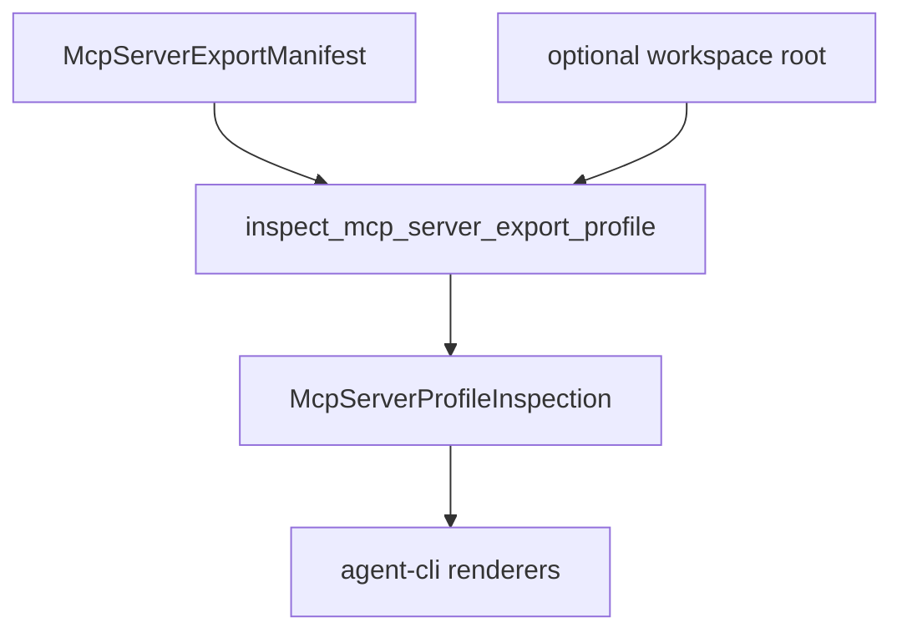

# M34-00 MCP Export Profile Inspection Technical Design Spec

## Purpose

Define a typed inspection and preflight architecture for MCP server export profiles.

## Product Context

MCP stdio export profiles now support resources and curated built-in tools. Users need a safe way to inspect those profiles before launching a protocol session, especially in scripts and configuration UIs.

## Scope

This spec delivers:

- inspection contract ownership
- diagnostic severity model
- CLI command shape
- JSON/text rendering boundaries
- redaction and no-content rules

Owned by other specs:

- runtime implementation slices M34-01 through M34-05
- Desktop UI for MCP management

## Architecture

`agent-mcp` builds an inspection from an already parsed manifest and optional workspace root. `agent-cli` reads files, parses args, and renders the typed result.



## File Layout

```text
crates/agent-mcp/src/server_manifest.rs
crates/agent-mcp/src/lib.rs
crates/agent-cli/src/command.rs
crates/agent-mcp/tests/mcp_server_profile_inspection.rs
crates/agent-cli/tests/mcp_server_profile_inspect_command.rs
```

## Public Contracts

```rust
pub enum McpServerProfileInspectionSeverity {
    Info,
    Warning,
    Error,
}

pub struct McpServerProfileInspectionOptions {
    pub profile_name: Option<String>,
    pub manifest_dir: PathBuf,
    pub workspace_root: Option<PathBuf>,
}

pub struct McpServerProfileInspection {
    pub profile_name: String,
    pub tools: Vec<McpServerProfileToolInspection>,
    pub resources: Vec<McpServerProfileResourceInspection>,
    pub diagnostics: Vec<McpServerProfileInspectionDiagnostic>,
}
```

## State and Failure Handling

- Parse errors remain hard errors.
- Selection errors remain hard errors.
- Profile content issues become diagnostics when inspection can safely continue.
- Inspection must not mutate registries or execute tools.

## Security and Privacy

- No resource contents are read into output.
- Secret-like names and paths are redacted or rejected through existing validation.
- Diagnostics are bounded.

## Testing Strategy

- unit tests for inspection serialization
- diagnostics tests for missing workspace, missing resource, unknown tool, disabled entries
- CLI JSON/text tests

## Acceptance Criteria

- Technical design supports every M34 slice without unresolved ownership questions.
- M34-01 can start from a concrete contract.

## Completion Signal

This design is complete when M34 slice specs/plans exist and the milestone index points to M34-01.
