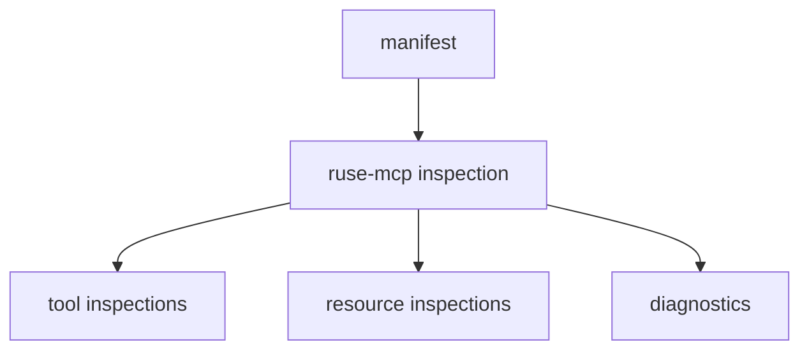

# M34-01 Profile Inspection Contracts Spec

## Purpose

Add typed MCP export profile inspection contracts in `ruse-mcp`.

## Product Context

Inspection is the runtime-owned summary used by CLI, JSON clients, and future Desktop views to understand an export profile without starting stdio.

## Scope

This spec delivers:

- serializable inspection structs
- selected profile summary
- enabled/disabled tool and resource entries
- initial diagnostics for workspace requirement and missing resources

Owned by other specs:

- CLI command parsing/rendering
- extended redaction regressions

## Architecture

`ruse-mcp::server_manifest` owns inspection because it already owns manifest parsing, profile selection, resource path resolution, and built-in catalog construction.



## File Layout

```text
crates/ruse-mcp/src/server_manifest.rs
crates/ruse-mcp/src/lib.rs
crates/ruse-mcp/tests/mcp_server_profile_inspection.rs
```

## Public Contracts

- `McpServerProfileInspection`
- `McpServerProfileInspectionOptions`
- `McpServerProfileInspectionDiagnostic`
- `McpServerProfileInspectionSeverity`
- `McpServerProfileToolInspection`
- `McpServerProfileResourceInspection`
- `inspect_mcp_server_export_profile`

## State and Failure Handling

- Unknown profile remains an error.
- Missing workspace for tool entries is an error diagnostic.
- Missing resource files are error diagnostics.
- Disabled entries are included with `enabled: false`.

## Security and Privacy

- Inspection reports paths, URIs, names, and booleans only.
- Resource contents are never read into the output.
- Diagnostics are bounded and redacted.

## Testing Strategy

- resource-only inspection test
- tool inspection with missing workspace diagnostic
- disabled entries test
- serde stable shape test

## Acceptance Criteria

- `CARGO_TARGET_DIR=target/codex-m34 cargo test -p ruse-mcp mcp_server_profile_inspection`
- `ruse-mcp` exports the inspection contracts.

## Completion Signal

M34-01 is complete when profile inspection contracts are public and tested.
