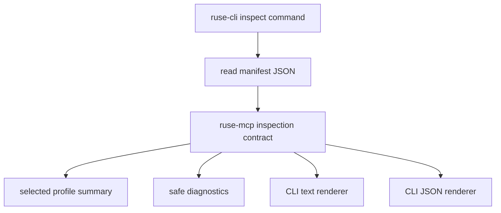

# M34 MCP Export Profile Inspection Spec

## Purpose

Add an inspect/preflight surface for MCP server export profiles so users can validate a manifest, selected profile, resources, built-in tool exports, workspace requirements, and safe diagnostics before starting the stdio protocol loop.

## Product Context

M32 made export profiles manifest-backed. M33 made curated built-in workspace tools callable from stdio profiles. M34 makes those profiles auditable and script-friendly: a user or automation can ask what will be exported, what is disabled, what requires `--workspace`, and why startup would fail without emitting MCP protocol frames.

## Scope

This spec delivers:

- typed profile inspection contracts in `ruse-mcp`
- profile preflight diagnostics for resources, tools, workspace roots, and catalog availability
- CLI inspect command with text and JSON output
- protocol-safe startup regression coverage
- README and milestone evidence

Owned by other specs:

- Desktop MCP profile management
- plugin-provided export catalogs
- side-effecting built-in tool exports
- live MCP HTTP server mode

## Architecture

`ruse-mcp` owns profile inspection contracts and preflight rules. `ruse-cli` owns file IO, argument parsing, and rendering. Rendering must use typed summaries rather than duplicating validation logic.



## Public Contracts

- `McpServerProfileInspection`
- `McpServerProfileInspectionOptions`
- `McpServerProfileInspectionDiagnostic`
- `inspect_mcp_server_export_profile`
- CLI command:

```bash
ruse-cli mcp server profile inspect --profile path/to/mcp-server-exports.json
ruse-cli mcp server profile inspect --profile path/to/mcp-server-exports.json --workspace .
ruse-cli --json mcp server profile inspect --profile path/to/mcp-server-exports.json --workspace .
```

## State and Failure Handling

- Invalid manifest JSON remains a command failure.
- Valid manifest with missing workspace for tools returns an inspection with error severity diagnostics.
- Missing resource files are reported through diagnostics without reading or printing file contents.
- Unknown tool names are reported with known allow-listed built-in tool names.
- JSON output remains stable and redacted for automation.

## Security and Privacy

- Inspection may list names, paths, URIs, counts, enabled flags, and diagnostics.
- Inspection must not print resource contents, raw tool inputs, secret-like values, or environment variables.
- Workspace validation uses `WorkspaceSandbox`.
- Startup behavior must not become more permissive because inspection exists.

## Testing Strategy

- `ruse-mcp` tests for typed inspection output and diagnostics.
- `ruse-cli` parser/rendering tests for text and JSON.
- regression tests for invalid manifests and protocol-only stdio output.
- final `cargo xtask ci`.

## Acceptance Criteria

- Users can inspect a resource-only profile without `--workspace`.
- Users can inspect a tool profile and see that `--workspace` is required.
- Users can inspect a tool profile with `--workspace` and see active built-in tool exports.
- JSON output is parseable, stable, and redacted.
- M34 final quality gate passes.

## Completion Signal

M34 is complete when all slice plans are checked off, README documents inspect usage, and `CARGO_TARGET_DIR=target/codex-m34 cargo xtask ci` passes.
