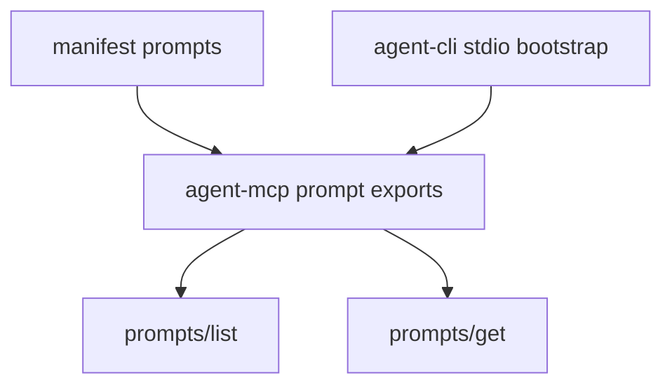

# M35-00 MCP Prompt Export Technical Design Spec

## Purpose

Define how the local MCP server exposes explicit prompt exports without leaking hidden prompt layers or mixing UI prompt inspection logic into protocol handling.

## Product Context

This supports the PRD MCP layer and prompt runtime goals by letting MCP clients discover prompt templates from the same local runtime that already owns prompt layering and inspection.

## Scope

This spec delivers:

- prompt export ownership
- protocol method boundary for `prompts/list` and `prompts/get`
- manifest extension shape
- CLI stdio startup wiring
- redaction and no-side-effect rules

Owned by implementation slices:

- concrete Rust prompt export structs
- registry implementation
- JSON-RPC frame behavior
- manifest parsing and CLI tests

## Architecture

`agent-mcp` should depend only on typed prompt export data, not on CLI-only default prompt helpers. `agent-cli` may construct a built-in prompt export from existing CLI prompt defaults until a later milestone moves that default catalog into a runtime crate.



## Public Contracts

Expected contracts:

```rust
pub struct McpPromptExport;
pub struct McpPromptDescriptor;
pub struct McpPromptMessage;
pub struct McpPromptListResult;
pub struct McpPromptGetResult;
pub struct McpPromptExportRegistry;
```

## State and Failure Handling

- `prompts/list` lists only enabled exports.
- `prompts/get` returns bounded messages for enabled exports.
- Unknown or disabled prompt names return invalid params.
- Invalid prompt export definitions fail before registry insertion.

## Security and Privacy

- Prompt messages must be explicitly supplied and bounded.
- Secret-like prompt names, descriptions, and messages are rejected or redacted before wire output.
- MCP prompt methods do not execute tools, read files, or assemble arbitrary runtime context.

## Testing Strategy

- contract serialization tests
- registry visibility tests
- stdio JSON-RPC tests
- manifest and CLI integration tests

## Acceptance Criteria

- M35 slice specs and plans are complete.
- M35-01 can start from concrete contracts and test targets.

## Completion Signal

This design is complete when M35 slice docs exist and the milestone index points to M35-01.
