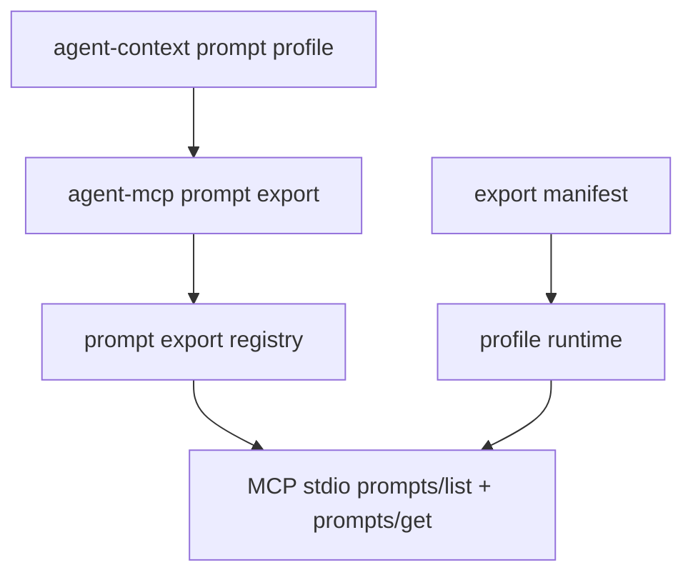

# M35 MCP Prompt Export Runtime Spec

## Purpose

Expose selected local prompt profiles through the MCP server prompt surface so MCP clients can discover safe prompt templates before invoking local tools or resources.

## Product Context

M30-M34 made the local MCP server useful for tools, resources, profiles, built-in workspace tools, and preflight inspection. M35 closes the next protocol gap by adding prompt exports backed by the existing `agent-context` prompt contracts.

## Scope

This milestone delivers:

- typed MCP prompt export contracts
- prompt export registry with enabled/disabled visibility
- JSON-RPC support for `prompts/list` and `prompts/get`
- manifest-backed prompt profile declarations
- CLI stdio integration and hardening docs

Owned by later milestones:

- Desktop MCP prompt management UI
- dynamic prompt editing through MCP clients
- prompt argument schemas beyond safe string parameters
- remote MCP prompt import

## Architecture

`agent-mcp` owns MCP prompt contracts, registry behavior, protocol frames, and profile runtime wiring. `agent-cli` only loads manifests and passes prompt exports into the stdio server session.

## State and Failure Handling

- Disabled prompt exports are retained in runtime internals but hidden from `prompts/list`.
- Unknown prompt names return JSON-RPC invalid params without leaking requested text.
- Prompt content is assembled from explicit prompt exports only, never from arbitrary project files during MCP calls.
- Prompt export loading fails before stdio startup if manifest prompt declarations are invalid.

## Security and Privacy

- Hidden or secret-like prompt layers are never emitted as raw content.
- Prompt messages are bounded and serialized through typed contracts.
- Prompt exports remain read-only and require no tool execution.
- Stdio stdout remains protocol-only.

## Testing Strategy

- registry contract tests for prompt descriptors and disabled visibility
- JSON-RPC fixture tests for `prompts/list` and `prompts/get`
- manifest parsing and CLI stdio integration tests
- redaction tests for hidden and secret-like prompt content

## Acceptance Criteria

- `CARGO_TARGET_DIR=target/codex-m35 cargo test -p agent-mcp mcp_server_prompt_export`
- `CARGO_TARGET_DIR=target/codex-m35 cargo test -p agent-cli mcp_server_prompt_profile`
- `CARGO_TARGET_DIR=target/codex-m35 cargo xtask ci`

## Completion Signal

M35 is complete when MCP stdio sessions can list and get explicit prompt exports from a manifest-backed profile with redacted, bounded protocol output.
