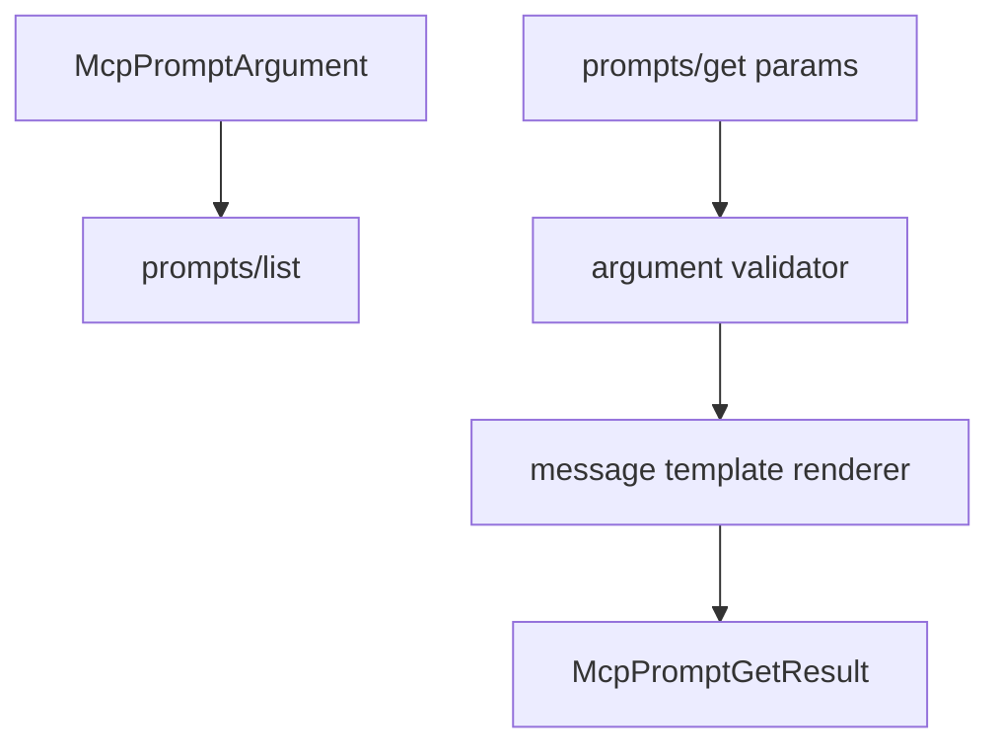

# M36-00 MCP Prompt Arguments Technical Design Spec

## Purpose

Define how MCP prompt exports declare and consume explicit prompt arguments while preserving protocol safety and local runtime boundaries.

## Product Context

M35 shipped static prompt exports. MCP clients naturally expect prompt descriptors to advertise arguments and `prompts/get` to render prompt content from caller-supplied values.

## Scope

This spec delivers:

- argument descriptor ownership
- `prompts/get` argument validation boundary
- deterministic template syntax
- manifest extension shape
- privacy and redaction rules

Owned by implementation slices:

- concrete Rust contracts
- template renderer behavior
- manifest parsing and profile wiring
- CLI stdio e2e tests

## Architecture

`agent-mcp` remains the protocol owner. Template rendering is local to prompt exports and accepts only a map of string arguments.



## Public Contracts

Expected contracts:

```rust
pub struct McpPromptArgument;
pub struct McpPromptGetParams;
pub struct McpPromptRenderContext;
```

## State and Failure Handling

- Missing required arguments return invalid params.
- Unknown arguments return invalid params.
- Template references to undeclared arguments fail during export construction.
- Optional missing arguments render as empty strings unless a later slice adds defaults.

## Security and Privacy

- Argument names and descriptions are public metadata and cannot be secret-like.
- Argument values are untrusted input and are bounded and redacted before output.
- Error diagnostics never echo raw secret-like values.

## Testing Strategy

- contract serialization tests
- validation tests for missing, unknown, and secret-like values
- renderer tests for deterministic substitution
- stdio JSON-RPC tests for argument payloads

## Acceptance Criteria

- M36 slice specs and plans are complete.
- M36-01 can start from concrete contracts and test targets.

## Completion Signal

This design is complete when M36 slice docs exist and the milestone index points to M36-01.
