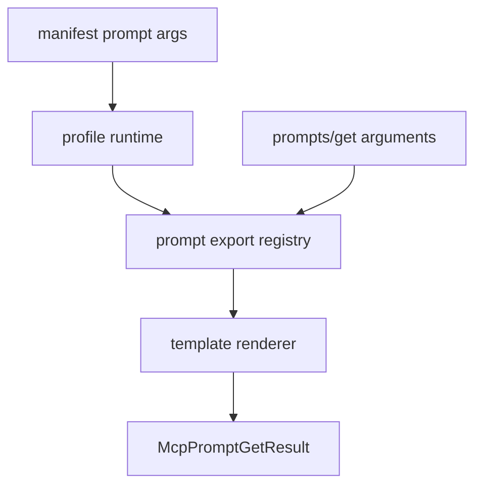

# M36 MCP Prompt Arguments Runtime Spec

## Purpose

Let MCP prompt exports declare explicit safe string arguments and render prompt message templates from `prompts/get` parameters.

## Product Context

M35 exposed static prompt exports through MCP. M36 makes those exports useful for repeatable workflows by allowing MCP clients to pass bounded arguments into declared prompt templates without giving MCP access to arbitrary context assembly, files, tools, or hidden prompt layers.

## Scope

This milestone delivers:

- typed MCP prompt argument descriptors
- `prompts/get` argument parsing and validation
- deterministic template rendering for explicit prompt messages
- manifest-backed prompt argument declarations
- CLI stdio e2e coverage and hardening docs

Owned by later milestones:

- complex JSON schemas for prompt arguments
- dynamic prompt editing through MCP clients
- prompt catalogs backed by `agent-context` profile registries
- remote MCP prompt import

## Architecture

`agent-mcp` owns prompt argument contracts, validation, template rendering, and JSON-RPC behavior. `agent-cli` only loads manifest declarations and passes profile runtime data into `agent-mcp`.

## State and Failure Handling

- Disabled prompts stay hidden from `prompts/list` and `prompts/get`.
- Required arguments must be present and non-empty.
- Unknown arguments are rejected to catch client drift.
- Argument values and rendered messages are bounded and redacted.
- Template references to undeclared arguments fail before registry insertion.

## Security and Privacy

- Arguments are explicit, string-only, bounded, and secret-aware.
- Rendering never reads files, executes tools, or assembles hidden prompt layers.
- Error messages redact secret-like names and values.
- Stdio stdout remains protocol-only.

## Testing Strategy

- contract tests for prompt argument descriptors
- renderer tests for required, optional, unknown, and missing arguments
- manifest parsing tests for prompt argument declarations
- CLI stdio tests for `prompts/get` with arguments
- redaction regressions for argument values and rendered output

## Acceptance Criteria

- `CARGO_TARGET_DIR=target/codex-m36 cargo test -p agent-mcp mcp_server_prompt_arguments`
- `CARGO_TARGET_DIR=target/codex-m36 cargo test -p agent-cli mcp_server_prompt_arguments`
- `CARGO_TARGET_DIR=target/codex-m36 cargo xtask ci`

## Completion Signal

M36 is complete when manifest-backed MCP prompt exports can declare arguments and render bounded prompt messages from `prompts/get` arguments through CLI stdio with final quality gate evidence.
