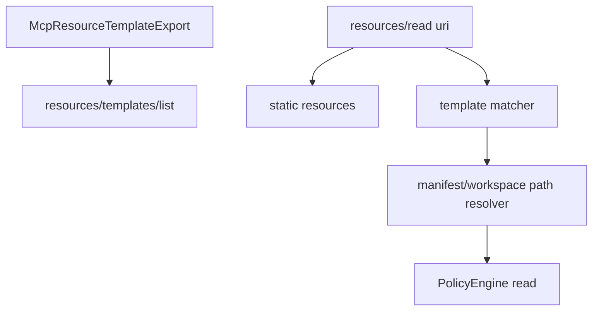

# M37-00 MCP Resource Templates Technical Design Spec

## Purpose

Define how MCP resource templates are declared, listed, matched, and resolved while preserving local runtime safety.

## Product Context

Static MCP resource exports require a profile author to enumerate every URI. MCP clients also support resource templates, so local profiles need a safe way to expose bounded parameterized resources such as workspace files under an explicit root.

## Scope

This spec delivers:

- resource template descriptor ownership
- conservative URI template syntax
- concrete URI matching rules
- manifest extension shape
- path resolution and policy boundaries
- privacy and redaction rules

Owned by implementation slices:

- concrete Rust contracts
- template matcher behavior
- manifest parsing and profile wiring
- CLI stdio e2e tests

## Architecture

`agent-mcp` remains the protocol owner. Resource templates live beside static resource exports and resolve concrete URIs into the existing resource read policy path.



## Public Contracts

Expected contracts:

```rust
pub struct McpResourceTemplateExport;
pub struct McpResourceTemplateMatch;
pub struct McpResourceTemplateReadRequest;
```

Wire descriptors use MCP-compatible camelCase fields:

```json
{
  "uriTemplate": "agent://workspace/file/{path}",
  "name": "Workspace file",
  "description": "Read a workspace file",
  "mimeType": "text/plain"
}
```

## State and Failure Handling

- Static resource URI matches win before template matching.
- Template matching is deterministic and ordered by descriptor URI template.
- Duplicate `uri_template` values are rejected at profile build time.
- Ambiguous concrete URI matches are rejected rather than guessed.
- Missing files, path escapes, and policy denials return redacted errors.

## Security and Privacy

- URI template variables are bounded strings with conservative names.
- Template variable values are validated before filesystem resolution.
- Path templates cannot resolve outside the manifest directory or workspace root.
- Diagnostics never include raw secret-like variable values or file contents.

## Testing Strategy

- descriptor serialization tests
- URI template parser and matcher tests
- path resolution tests for traversal and invalid values
- policy-denied template read tests
- stdio JSON-RPC tests for list and read behavior

## Acceptance Criteria

- M37 slice specs and plans are complete.
- M37-01 can start from concrete contracts and test targets.

## Completion Signal

This design is complete when M37 slice docs exist and the milestone index points to M37-01.
