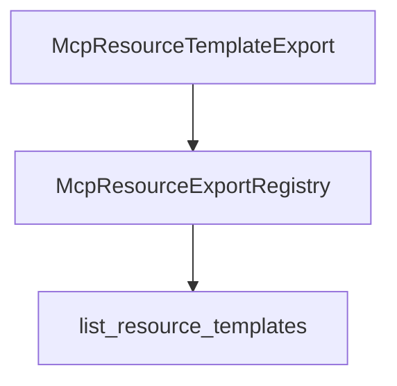

# M37-01 Resource Template Contracts Spec

## Purpose

Add serializable MCP resource template contracts and registry listing behavior.

## Product Context

M37 starts by making resource template descriptors a typed public contract before adding matching or manifest-backed loading.

## Scope

This spec delivers:

- `McpResourceTemplateExport` descriptor
- resource template registry insertion and listing
- duplicate and disabled template handling
- stable MCP JSON field names

Owned by later M37 specs:

- concrete URI matching
- manifest resource template declarations
- CLI stdio protocol methods

## Architecture

Contracts live in `ruse-mcp` beside static resource export contracts.



## Public Contracts

Expected descriptor:

```rust
pub struct McpResourceTemplateExport {
    pub uri_template: String,
    pub name: String,
    pub description: Option<String>,
    pub mime_type: Option<String>,
    pub enabled: bool,
}
```

Serde output must use MCP-compatible fields: `uriTemplate` and `mimeType`.

## State and Failure Handling

- Empty names and invalid URI templates are rejected.
- Duplicate URI templates are rejected.
- Disabled templates are retained for inspection but hidden from active listings.
- Secret-like metadata is rejected or redacted consistently with static resources.

## Security and Privacy

- Template metadata is public discovery data.
- Descriptions are bounded.
- No template read or filesystem access occurs in this slice.

## Testing Strategy

- serialization shape tests
- duplicate rejection tests
- enabled/disabled listing tests
- metadata validation tests

## Acceptance Criteria

- `CARGO_TARGET_DIR=target/codex-m37 cargo test -p ruse-mcp mcp_server_resource_template_contracts`
- `CARGO_TARGET_DIR=target/codex-m37 cargo clippy -p ruse-mcp --all-targets -- -D warnings`

## Completion Signal

M37-01 is complete when resource template descriptors can be registered and listed with stable JSON shape.
