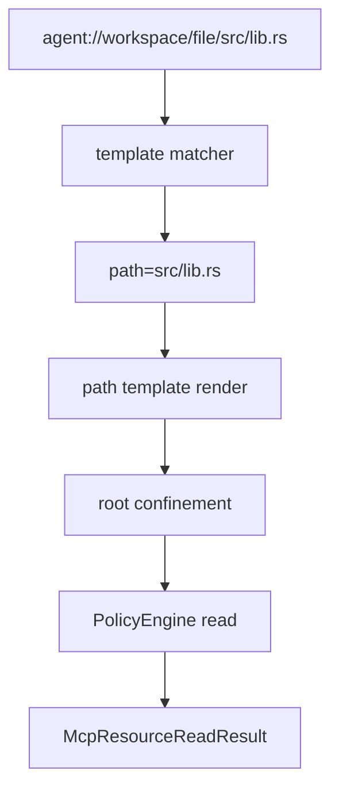

# M37-02 Resource Template Matching Spec

## Purpose

Resolve concrete MCP resource URIs against declared templates and read the corresponding local file safely.

## Product Context

After M37-01 exposes template descriptors, clients need `resources/read` to accept concrete URIs that match those templates.

## Scope

This spec delivers:

- URI template parser for `{variable}` segments
- deterministic concrete URI matching
- path template rendering from matched variables
- root-confined file resolution
- policy-gated template-backed reads

Owned by later M37 specs:

- manifest schema for declaring templates
- stdio method routing for `resources/templates/list`
- README docs and final quality gates

## Architecture

Template-backed reads reuse the same registry and policy path as static resources.



## Public Contracts

Expected internal contracts:

```rust
pub struct McpResourceTemplateMatch {
    pub uri_template: String,
    pub uri: String,
    pub variables: BTreeMap<String, String>,
}
```

## State and Failure Handling

- Static resource reads are attempted before template matching.
- No matching template returns resource not found.
- Multiple matching templates return an ambiguity error.
- Missing resolved files return invalid params without content leakage.
- Path traversal and absolute paths are rejected before policy evaluation.

## Security and Privacy

- Variable names are public and bounded.
- Variable values are untrusted, bounded, and redacted in diagnostics.
- Reads use existing `CapabilityAction::Read` policy checks.
- File contents are bounded by the existing max resource content setting.

## Testing Strategy

- parser tests for literal and variable segments
- matcher tests for success, no match, ambiguity, malformed URI
- path traversal and absolute path rejection tests
- policy denied read test with no content leakage
- content truncation regression test

## Acceptance Criteria

- `CARGO_TARGET_DIR=target/codex-m37 cargo test -p agent-mcp mcp_server_resource_template_matching`
- `CARGO_TARGET_DIR=target/codex-m37 cargo clippy -p agent-mcp --all-targets -- -D warnings`

## Completion Signal

M37-02 is complete when concrete URIs can be matched and safely read through the resource registry in unit/integration tests.
