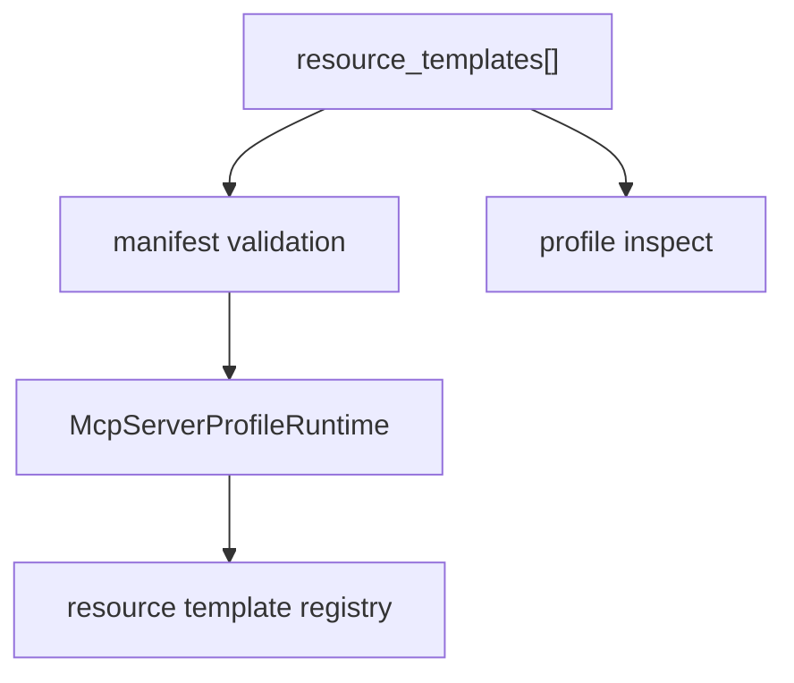

# M37-03 Manifest Resource Templates Spec

## Purpose

Load resource template declarations from MCP server export manifests and expose them in profile inspection.

## Product Context

MCP resource templates must be declarative so profile authors can review exactly which parameterized resource surfaces are exported before starting stdio.

## Scope

This spec delivers:

- manifest `resource_templates` declarations
- path template fields resolved relative to manifest directory or workspace root
- profile runtime construction for templates
- inspection summaries without reading template contents
- preflight diagnostics for invalid roots, missing roots, duplicates, disabled templates, and unsafe path templates

Owned by later M37 specs:

- stdio `resources/templates/list`
- README usage docs

## Architecture

Manifest parsing stays in `ruse-mcp`; `ruse-cli` continues to pass manifest path, selected profile, and optional workspace.



## Public Contracts

Expected manifest shape:

```json
{
  "resource_templates": [
    {
      "uri_template": "agent://workspace/file/{path}",
      "name": "Workspace file",
      "description": "Read a workspace file",
      "path_template": "{path}",
      "mime_type": "text/plain",
      "enabled": true,
      "sensitive": false
    }
  ]
}
```

## State and Failure Handling

- Duplicate `uri_template` values in one profile are rejected.
- Disabled templates are inspectable but hidden from active listings.
- Unsafe `path_template` values fail profile startup or preflight.
- Missing file diagnostics happen for static resources, not every possible template value.

## Security and Privacy

- Inspection shows metadata, not file contents or resolved variable values.
- Secret-like metadata is redacted.
- Template paths cannot escape the selected root.

## Testing Strategy

- manifest serde round-trip tests
- runtime builder tests for visible and disabled templates
- duplicate template rejection tests
- inspection JSON redaction tests
- preflight diagnostics tests for unsafe path templates

## Acceptance Criteria

- `CARGO_TARGET_DIR=target/codex-m37 cargo test -p ruse-mcp mcp_server_manifest_resource_templates`
- `CARGO_TARGET_DIR=target/codex-m37 cargo clippy -p ruse-mcp --all-targets -- -D warnings`

## Completion Signal

M37-03 is complete when manifests can declare resource templates and profile inspection reports them safely.
