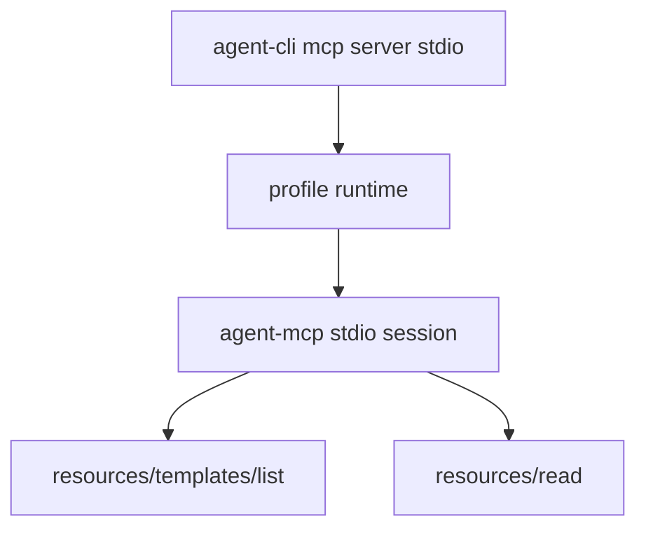

# M37-04 CLI Stdio Resource Templates Spec

## Purpose

Expose MCP resource templates through the CLI stdio server without adding runtime logic to the CLI layer.

## Product Context

Manifest-backed resource templates become useful when an MCP client can discover them through `resources/templates/list` and read concrete URIs through `resources/read`.

## Scope

This spec delivers:

- `resources/templates/list` JSON-RPC routing
- stdio e2e tests for resource template discovery
- stdio e2e tests for template-backed `resources/read`
- invalid read tests for traversal and unknown concrete URIs
- protocol-only stdout regression coverage

Owned by other specs:

- template contracts and matching are owned by `agent-mcp`
- manifest parsing is owned by M37-03

## Architecture

`agent-cli` remains an IO/bootstrap layer. Stdio protocol handling remains in `agent-mcp`.

## State and Failure Handling

- `resources/templates/list` requires initialization.
- Disabled templates are hidden from active listings.
- Template-backed read errors are returned as JSON-RPC invalid params.
- CLI stderr may contain diagnostics; stdout remains MCP protocol frames only.

## Security and Privacy

- CLI must not inspect template contents or resolve paths outside `agent-mcp`.
- Invalid template reads must not leak local absolute paths or file contents.
- `--json` remains rejected for stdio server mode.

## Testing Strategy

- IO fixture tests for list and read frames
- binary smoke test for stdout protocol purity
- invalid concrete URI and traversal tests
- JSON parse tests for descriptor field names

## Acceptance Criteria

- `CARGO_TARGET_DIR=target/codex-m37 cargo test -p agent-cli mcp_server_resource_templates`
- `CARGO_TARGET_DIR=target/codex-m37 cargo clippy -p agent-cli --all-targets -- -D warnings`

## Completion Signal

M37-04 is complete when CLI stdio serves manifest resource templates through MCP protocol frames only.
