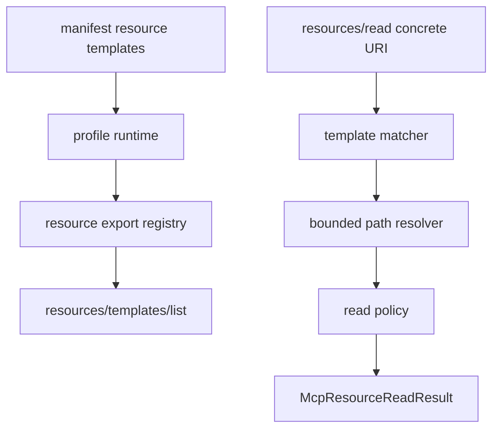

# M37 MCP Resource Templates Runtime Spec

## Purpose

Let MCP server profiles expose explicit parameterized resource templates and resolve safe concrete resource URIs through `resources/read`.

## Product Context

M30-M34 established static MCP resource exports. M37 makes resource exports useful for repeatable clients that need to discover a URI template, fill bounded string variables, and read concrete local resources without granting arbitrary filesystem or tool access.

## Scope

This milestone delivers:

- typed MCP resource template descriptors
- deterministic URI template parsing and concrete URI matching
- manifest-backed resource template declarations
- `resources/templates/list` JSON-RPC support
- `resources/read` resolution for concrete URIs produced by declared templates
- CLI stdio e2e coverage and hardening docs

Owned by later milestones:

- resource subscription notifications
- dynamic resource change tracking
- remote resource providers
- non-file template backends
- full JSON-schema parameter contracts

## Architecture

`ruse-mcp` owns template contracts, matching, validation, policy mapping, and JSON-RPC behavior. `ruse-cli` only loads manifest declarations and passes profile runtime data into `ruse-mcp`.

## State and Failure Handling

- Disabled templates stay hidden from `resources/templates/list` and cannot resolve reads.
- Template variables are string-only, bounded, and validated before path resolution.
- Concrete URI reads first check static resources, then enabled templates.
- Unknown concrete URIs return invalid params without leaking filesystem paths.
- Resolved file paths must stay under the manifest directory or selected workspace root.
- Policy denial and read failures return bounded, redacted diagnostics.

## Security and Privacy

- Template metadata is public but cannot contain secret-like text.
- Template variable values are untrusted input and are never echoed raw in diagnostics.
- Template-backed reads use the same policy path as static resource reads.
- Manifest path templates cannot escape the configured root.
- Stdio stdout remains protocol-only.

## Testing Strategy

- contract tests for resource template descriptors
- matcher tests for concrete URI extraction and invalid URI rejection
- manifest tests for template declarations, duplicates, disabled templates, and preflight diagnostics
- stdio tests for `resources/templates/list` and template-backed `resources/read`
- redaction regressions for secret-like template variables and resolved paths

## Acceptance Criteria

- `CARGO_TARGET_DIR=target/codex-m37 cargo test -p ruse-mcp mcp_server_resource_template`
- `CARGO_TARGET_DIR=target/codex-m37 cargo test -p ruse-cli mcp_server_resource_template`
- `CARGO_TARGET_DIR=target/codex-m37 cargo xtask ci`

## Completion Signal

M37 is complete when manifest-backed MCP resource templates can be listed and safely resolved through CLI stdio `resources/read` with final quality gate evidence.
