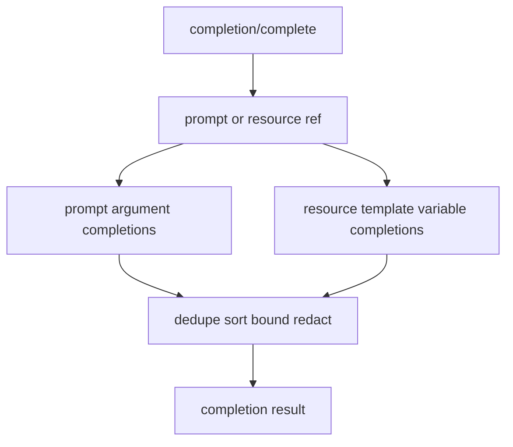

# M38-00 MCP Completion Technical Design Spec

## Purpose

Define how MCP completions are requested, resolved, bounded, and exposed for local prompt arguments and resource template variables.

## Product Context

Prompt arguments and resource template variables are now explicit contracts, but clients still need to know useful values. Completion support gives clients a protocol-native helper while preserving local-first safety and avoiding dynamic discovery side effects.

## Scope

This spec delivers:

- completion ref handling for prompts and resources
- argument name and prefix validation
- static completion source ownership
- manifest extension shape
- response bounds and deterministic ordering
- privacy and redaction rules

Owned by implementation slices:

- concrete Rust contracts
- prompt argument completion lookup
- resource template completion lookup
- manifest parsing and profile wiring
- CLI stdio e2e tests

## Architecture

Completion lives in `ruse-mcp` beside prompt and resource exports. It resolves against already-declared exports and static completion sources.



## Public Contracts

Expected contracts:

```rust
pub struct McpCompletionRequest;
pub enum McpCompletionRef;
pub struct McpCompletionArgument;
pub struct McpCompletionResult;
pub struct McpCompletionSource;
```

Wire request shape:

```json
{
  "ref": { "type": "ref/prompt", "name": "review" },
  "argument": { "name": "topic", "value": "work" }
}
```

Wire response shape:

```json
{
  "completion": {
    "values": ["workspace diff"],
    "total": 1,
    "hasMore": false
  }
}
```

## State and Failure Handling

- Completion is available only after `initialize`.
- Completion never mutates prompt, resource, policy, memory, or trace state beyond normal redacted request tracing.
- Unknown refs and undeclared argument names fail with invalid params.
- Disabled exports are treated as unavailable.
- Empty prefixes are valid and return the first bounded static values.

## Security and Privacy

- Completion sources are explicit profile data.
- Completion values are bounded and rejected if secret-like.
- Prefix values are validated and redacted in diagnostics.
- Completion does not inspect filesystem paths, read files, execute tools, or call models.

## Testing Strategy

- serde tests for prompt and resource refs
- response shape tests for `hasMore`, `total`, and bounded values
- invalid ref and unknown argument tests
- redaction tests for secret-like argument values
- technical design completion updates in milestone index

## Acceptance Criteria

- M38 slice specs and plans are complete.
- M38-01 can start from concrete contracts and test targets.

## Completion Signal

This design is complete when M38 slice docs exist and the milestone index points to M38-01.
