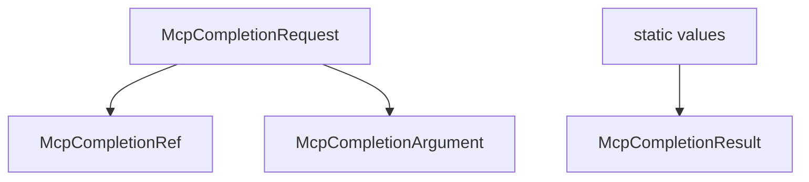

# M38-01 Completion Contracts Spec

## Purpose

Add serializable MCP completion request and response contracts plus deterministic value bounding helpers.

## Product Context

M38 starts by making `completion/complete` a typed public contract before connecting it to prompt arguments, resource templates, manifests, or stdio.

## Scope

This spec delivers:

- `McpCompletionRequest`
- `McpCompletionRef`
- `McpCompletionArgument`
- `McpCompletionResult`
- value validation, deduplication, sorting, prefix filtering, and bounds

Owned by later M38 specs:

- prompt argument completion lookup
- resource template variable completion lookup
- manifest completion declarations
- CLI stdio protocol method

## Architecture

Contracts live in `agent-mcp`, independent from CLI presentation.



## Public Contracts

Expected request:

```rust
pub struct McpCompletionRequest {
    pub completion_ref: McpCompletionRef,
    pub argument: McpCompletionArgument,
}
```

Expected result:

```rust
pub struct McpCompletionResult {
    pub values: Vec<String>,
    pub total: usize,
    pub has_more: bool,
}
```

Serde output must use MCP-compatible fields: `ref` and `hasMore`.

## State and Failure Handling

- Empty argument names are rejected.
- Secret-like refs, names, prefixes, and values are rejected or redacted.
- Duplicate completion values collapse to one value.
- Results are deterministic for identical inputs.
- Values beyond the configured limit set `hasMore` to true.

## Security and Privacy

- Completion values are public suggestions.
- No filesystem, tool, model, policy, or prompt rendering happens in this slice.
- Error messages are bounded and redacted.

## Testing Strategy

- serialization shape tests
- prefix filtering tests
- duplicate sorting and bounding tests
- invalid metadata and secret-like value tests

## Acceptance Criteria

- `CARGO_TARGET_DIR=target/codex-m38 cargo test -p agent-mcp mcp_server_completion_contracts`
- `CARGO_TARGET_DIR=target/codex-m38 cargo clippy -p agent-mcp --all-targets -- -D warnings`

## Completion Signal

M38-01 is complete when completion requests and bounded results have stable serde contracts and focused tests.
