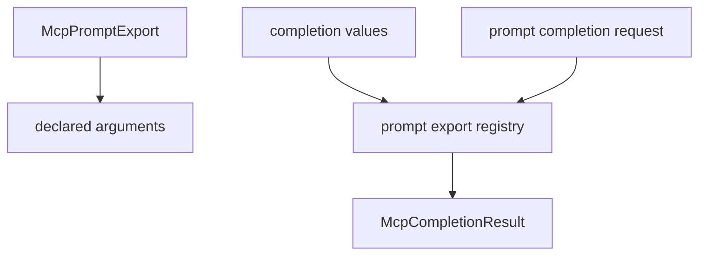

# M38-02 Prompt Argument Completions Spec

## Purpose

Allow prompt exports to declare static completion values for specific prompt arguments.

## Product Context

Prompt arguments are explicit and safe, but clients cannot discover useful values. Static prompt argument completions give clients constrained suggestions for common workflow inputs such as topics, tones, review modes, or target scopes.

## Scope

This spec delivers:

- prompt argument completion source storage
- lookup by prompt name and argument name
- disabled prompt behavior
- manifest-ready source contracts

Owned by later M38 specs:

- resource template completions
- CLI stdio method wiring
- README hardening docs

## Architecture

Prompt completion sources live beside `McpPromptExportRegistry` and validate against declared prompt arguments.



## Public Contracts

Expected API shape:

```rust
pub struct McpPromptArgumentCompletionSource;

impl McpPromptExportRegistry {
    pub fn complete_prompt_argument(
        &self,
        prompt_name: &str,
        argument_name: &str,
        prefix: &str,
    ) -> Result<McpCompletionResult, McpError>;
}
```

## State and Failure Handling

- Completion sources must reference declared prompt arguments.
- Disabled prompts are hidden from completion.
- Unknown prompts and unknown arguments return invalid request errors.
- Arguments without completion sources return an empty completion result.

## Security and Privacy

- Prompt completion values are static profile metadata.
- Secret-like values are rejected during registration.
- Completion never renders prompt messages or exposes hidden prompt content.

## Testing Strategy

- prompt registry completion lookup tests
- undeclared argument source rejection tests
- disabled prompt completion tests
- empty source and prefix filtering tests
- manifest-ready contract tests

## Acceptance Criteria

- `CARGO_TARGET_DIR=target/codex-m38 cargo test -p agent-mcp mcp_server_prompt_completions`
- `CARGO_TARGET_DIR=target/codex-m38 cargo clippy -p agent-mcp --all-targets -- -D warnings`

## Completion Signal

M38-02 is complete when prompt argument completion values can be registered and resolved through typed `agent-mcp` APIs.
