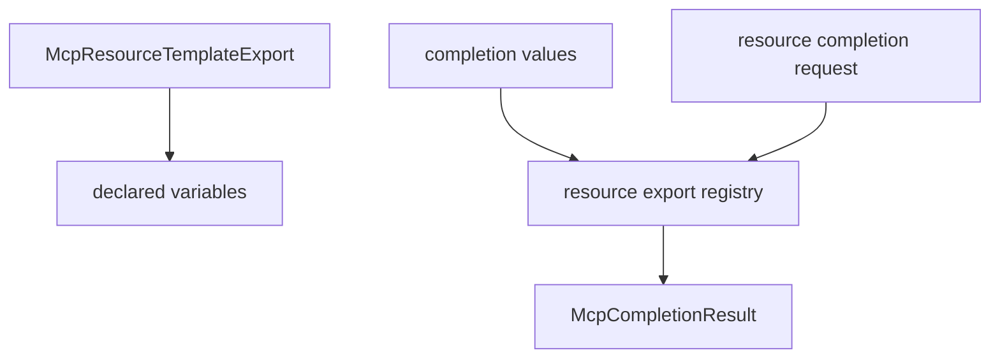

# M38-03 Resource Template Completions Spec

## Purpose

Allow resource templates to declare static completion values for specific URI template variables.

## Product Context

Resource templates expose parameterized URI surfaces. Static variable completions help MCP clients fill safe known values without letting the server browse local files dynamically.

## Scope

This spec delivers:

- resource template variable completion source storage
- lookup by resource template URI and variable name
- disabled template behavior
- manifest-ready source contracts

Owned by later M38 specs:

- CLI stdio `completion/complete` dispatch
- README hardening docs
- dynamic filesystem-backed completion providers

## Architecture

Resource completion sources live in `McpResourceExportRegistry` beside resource template records.



## Public Contracts

Expected API shape:

```rust
pub struct McpResourceTemplateCompletionSource;

impl McpResourceExportRegistry {
    pub fn complete_resource_template_variable(
        &self,
        uri_template: &str,
        variable_name: &str,
        prefix: &str,
    ) -> Result<McpCompletionResult, McpError>;
}
```

## State and Failure Handling

- Completion sources must reference variables declared in the URI template.
- Disabled resource templates are hidden from completion.
- Unknown templates and unknown variables return invalid request errors.
- Variables without completion sources return an empty completion result.

## Security and Privacy

- Completion values are explicit manifest/profile metadata.
- Completion does not inspect directories, check file existence, or read files.
- Secret-like values are rejected during registration.
- Error messages are bounded and redacted.

## Testing Strategy

- resource template completion lookup tests
- undeclared variable source rejection tests
- disabled template completion tests
- prefix filtering and empty completion tests
- redaction tests for secret-like values

## Acceptance Criteria

- `CARGO_TARGET_DIR=target/codex-m38 cargo test -p agent-mcp mcp_server_resource_template_completions`
- `CARGO_TARGET_DIR=target/codex-m38 cargo clippy -p agent-mcp --all-targets -- -D warnings`

## Completion Signal

M38-03 is complete when resource template variable completion values can be registered and resolved through typed `agent-mcp` APIs.
