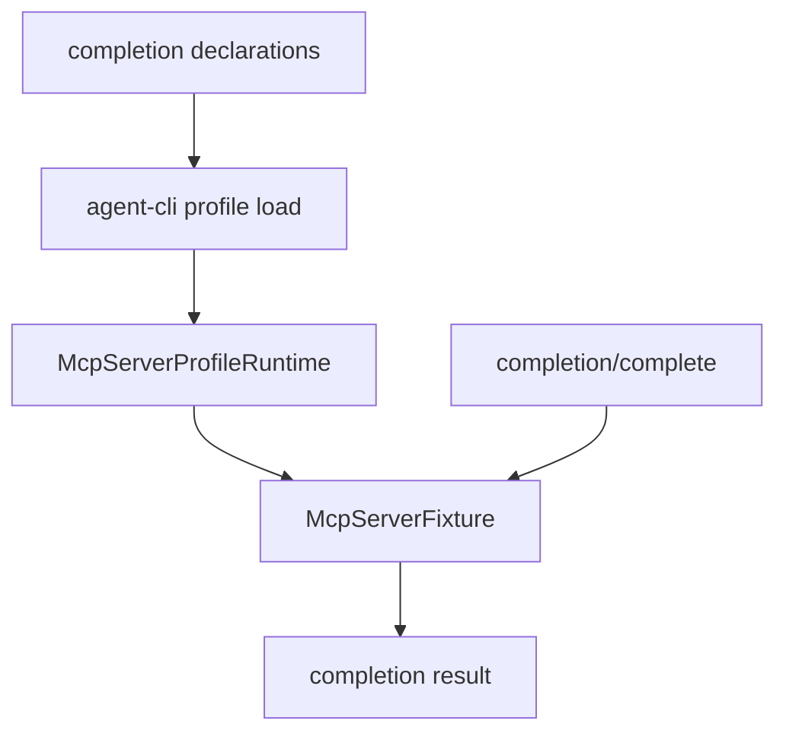

# M38-04 CLI Stdio Completions Spec

## Purpose

Serve manifest-backed prompt and resource completions through MCP stdio `completion/complete`.

## Product Context

Typed completion APIs become useful when MCP clients can call the local stdio server with the standard method and receive protocol-shaped bounded suggestions.

## Scope

This spec delivers:

- manifest fields for static completion values
- profile runtime wiring for prompt and resource completion sources
- `completion/complete` method parsing and dispatch
- CLI stdio e2e coverage
- profile inspection visibility for completion metadata

Owned by later M38 specs:

- final README usage docs
- final milestone status and quality gate evidence

## Architecture

`agent-cli` loads manifest declarations. `agent-mcp` owns dispatch and completion resolution.



## Public Contracts

Manifest shape:

```json
{
  "prompts": [
    {
      "name": "review",
      "arguments": [{ "name": "topic" }],
      "argument_completions": [
        { "argument": "topic", "values": ["workspace diff"] }
      ],
      "messages": [{ "role": "user", "text": "Review {{topic}}" }]
    }
  ],
  "resource_templates": [
    {
      "uri_template": "agent://workspace/file/{path}",
      "name": "Workspace file",
      "path_template": "{path}",
      "variable_completions": [
        { "variable": "path", "values": ["README.md"] }
      ]
    }
  ]
}
```

## State and Failure Handling

- `completion/complete` before initialization returns invalid request.
- `--json` remains rejected for stdio server mode.
- Malformed completion params return protocol errors on stdout.
- Stdio diagnostics and summaries do not include raw completion values when secret-like input is rejected.

## Security and Privacy

- Stdio stdout remains MCP protocol-only.
- Completion values are explicit static manifest metadata.
- Manifest validation rejects secret-like completion values.
- Completion does not read resource contents or prompt messages.

## Testing Strategy

- manifest parse and profile build tests
- CLI stdio tests for prompt argument completion
- CLI stdio tests for resource variable completion
- invalid params and before-initialize tests
- profile inspect redaction tests

## Acceptance Criteria

- `CARGO_TARGET_DIR=target/codex-m38 cargo test -p agent-mcp mcp_server_manifest_completions`
- `CARGO_TARGET_DIR=target/codex-m38 cargo test -p agent-cli mcp_server_completions`
- `CARGO_TARGET_DIR=target/codex-m38 cargo clippy -p agent-cli --all-targets -- -D warnings`

## Completion Signal

M38-04 is complete when CLI stdio can serve prompt and resource completions from a manifest-backed profile.
