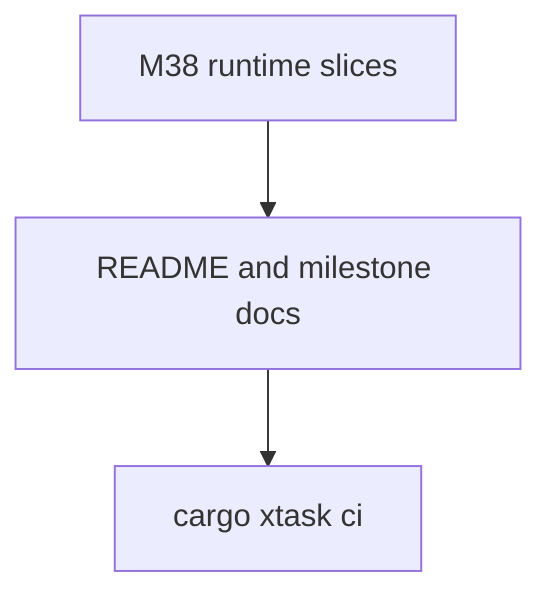

# M38-05 Hardening Docs Spec

## Purpose

Complete M38 documentation, redaction checks, milestone status, and final quality gate evidence.

## Product Context

After completion contracts, registries, manifest loading, and stdio dispatch are implemented, users need concise usage docs and maintainers need the milestone index to reflect the current runtime state.

## Scope

This spec delivers:

- README usage docs for MCP completions
- milestone status updates
- final focused test evidence
- final workspace quality gate evidence
- completion of M38 planning checklist

Owned by later milestones:

- dynamic completion providers
- richer completion ranking or pagination
- remote MCP client completion integration

## Architecture

Documentation only. Runtime behavior must already be implemented in `agent-mcp` and wired through `agent-cli`.

## State and Failure Handling

- README examples must match implemented JSON-RPC behavior.
- Milestone status must not point active work at completed slices.
- Verification commands must use `CARGO_TARGET_DIR=target/codex-m38`.

## Security and Privacy

- Docs must state that completion values are explicit static metadata.
- Docs must state that completion does not read files, execute tools, or expose prompt message text.
- Stdio stdout protocol-only behavior remains documented.

## Testing Strategy

- focused M38 tests
- `cargo xtask ci`
- markdown diff review for stale M37 active-work references

## Acceptance Criteria

- `CARGO_TARGET_DIR=target/codex-m38 cargo test -p agent-mcp mcp_server_completion`
- `CARGO_TARGET_DIR=target/codex-m38 cargo test -p agent-cli mcp_server_completions`
- `CARGO_TARGET_DIR=target/codex-m38 cargo xtask ci`

## Completion Signal

M38 is complete when docs describe completion usage, milestone status marks M38 complete, and final quality gate evidence is recorded.
