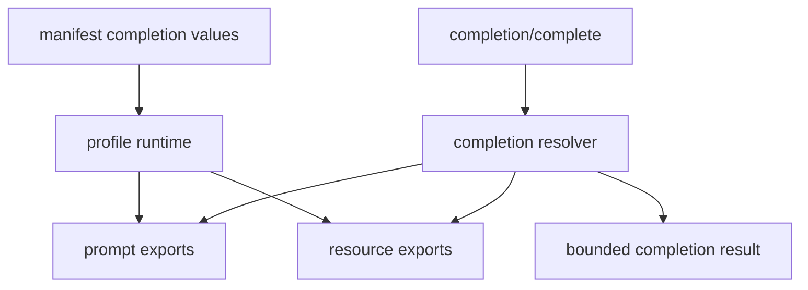

# M38 MCP Completion Runtime Spec

## Purpose

Let MCP clients request bounded completion suggestions for declared prompt arguments and resource template variables through `completion/complete`.

## Product Context

M35-M37 exposed prompts, prompt arguments, and resource templates through the local MCP server. M38 makes those surfaces easier for clients to use by adding safe completion contracts without granting clients dynamic filesystem browsing, hidden prompt access, tool execution, or unrestricted local discovery.

## Scope

This milestone delivers:

- typed MCP completion request and response contracts
- completion source declarations for prompt arguments
- completion source declarations for resource template variables
- `completion/complete` JSON-RPC support in `ruse-mcp`
- manifest-backed static completion values
- CLI stdio e2e coverage and hardening docs

Owned by later milestones:

- dynamic completion providers backed by tools or model calls
- file-system directory crawling completions
- pagination beyond bounded local values
- remote MCP completion import
- user-personalized completion ranking

## Architecture

`ruse-mcp` owns completion contracts, validation, source lookup, redaction, and JSON-RPC behavior. `ruse-cli` only loads manifest completion declarations and passes profile runtime data into `ruse-mcp`.

## State and Failure Handling

- Completion requests require initialized MCP server state.
- Unknown prompt names, resource templates, or argument names return bounded invalid params errors.
- Disabled prompts and resource templates do not produce completions.
- Completion values are prefix-filtered, deduplicated, sorted, bounded, and redacted.
- Completion has no side effects and does not issue permission leases.

## Security and Privacy

- Completion metadata is public discovery data.
- Static completion values cannot contain secret-like text unless a future sensitive completion contract exists.
- Diagnostics never echo raw secret-like values.
- Completion does not read local files or execute tools in M38.
- Stdio stdout remains protocol-only.

## Testing Strategy

- contract tests for completion request and result serde shape
- registry tests for prompt argument completion lookup
- registry tests for resource template variable completion lookup
- manifest parsing tests for completion declarations
- stdio tests for `completion/complete`
- redaction regressions for secret-like completion inputs

## Acceptance Criteria

- `CARGO_TARGET_DIR=target/codex-m38 cargo test -p ruse-mcp mcp_server_completion`
- `CARGO_TARGET_DIR=target/codex-m38 cargo test -p ruse-cli mcp_server_completions`
- `CARGO_TARGET_DIR=target/codex-m38 cargo xtask ci`

## Completion Signal

M38 is complete when manifest-backed MCP prompt argument and resource template completions can be served through CLI stdio `completion/complete` with final quality gate evidence.
