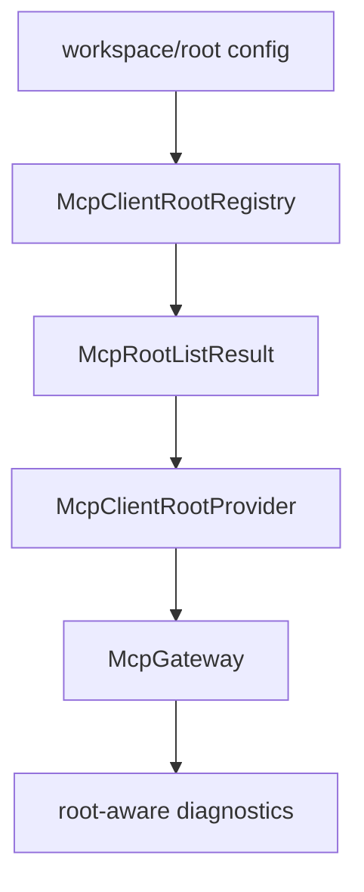

# M39-00 MCP Client Roots Technical Design Spec

## Purpose

Define how `agent` provides explicit MCP client roots to external MCP servers without changing local permission boundaries.

## Product Context

The gateway can discover and execute external MCP tools, while the local MCP server can now export tools, resources, prompts, templates, and completions. Roots complete an important client-side protocol primitive: an external server can ask what local workspace roots are relevant before exposing tools or resources.

## Scope

This spec delivers:

- protocol direction decision: roots are handled as client-provided data
- root URI and display name contract
- client roots capability metadata
- registry ownership and validation rules
- fixture behavior for `roots/list`
- gateway diagnostics and redaction rules

Owned by implementation slices:

- concrete Rust contracts
- registry and workspace validation
- fixture client/session behavior
- gateway integration
- README and milestone hardening docs

## Architecture

Root data lives in `agent-mcp` because it is MCP protocol state. The registry accepts only explicit file roots supplied by trusted runtime configuration or workspace setup code. Tool execution still depends on local policy.



## Public Contracts

Expected contracts:

```rust
pub struct McpRoot;
pub struct McpRootListResult;
pub struct McpClientRootsCapability;
pub struct McpClientCapabilities;
pub struct McpClientRootRegistry;
pub trait McpClientRootProvider;
```

Wire response shape:

```json
{
  "roots": [
    {
      "uri": "file:///workspace/project",
      "name": "project"
    }
  ]
}
```

## State and Failure Handling

- Root list results are deterministic and sorted by URI.
- Duplicate root URIs collapse to one root only when metadata is identical; conflicting duplicates fail validation.
- Empty root sets are valid when a server is allowed but has no root access.
- Invalid roots fail before gateway discovery.
- Root listing is read-only and idempotent.

## Security and Privacy

- Roots are treated as untrusted protocol-visible metadata.
- A root does not grant filesystem read, write, command, Git, browser, or secret access.
- Names and diagnostics reject or redact secret-like text.
- Canonicalized file paths must remain inside the configured workspace root set.
- Non-file schemes are reserved for later explicit specs.

## Testing Strategy

- serde shape tests for root contracts
- registry validation tests for URI/path/name rules
- fixture roots/list tests
- gateway report snapshot tests for root diagnostics
- documentation index checks through `git diff --check`

## Acceptance Criteria

- M39 slice specs and plans are complete.
- M39-01 can start from concrete contracts and focused test targets.

## Completion Signal

This design is complete when M39 slice docs exist and the milestone index points to M39-01.
