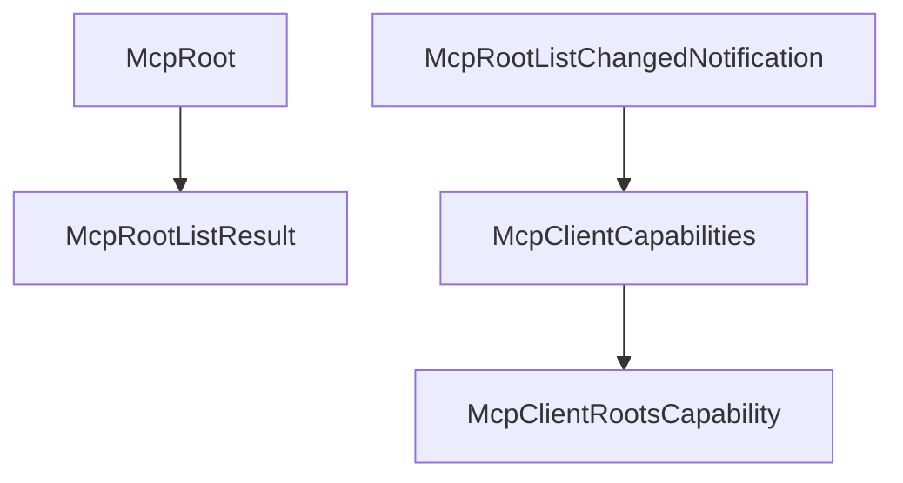

# M39-01 Client Root Contracts Spec

## Purpose

Add serializable MCP client root contracts, list result shape, client capability metadata, and typed root-list notification contracts.

## Product Context

M39 starts with stable protocol data types before adding validation, fixture behavior, or gateway usage.

## Scope

This spec delivers:

- `McpRoot`
- `McpRootListResult`
- `McpClientRootsCapability`
- `McpClientCapabilities`
- `McpRootListChangedNotification`
- serde-compatible root list result shape

Owned by later M39 specs:

- path canonicalization and registry validation
- fixture client roots/list behavior
- gateway diagnostics
- hardening docs

## Architecture

Contracts live in `ruse-mcp`, independent from CLI and Desktop presentation.



## Public Contracts

Expected contracts:

```rust
pub struct McpRoot {
    pub uri: String,
    pub name: Option<String>,
}

pub struct McpRootListResult {
    pub roots: Vec<McpRoot>,
}

pub struct McpClientRootsCapability {
    pub list_changed: bool,
}

pub struct McpClientCapabilities {
    pub roots: Option<McpClientRootsCapability>,
}
```

Serde must use MCP-compatible camelCase for `listChanged`.

## State and Failure Handling

- Empty root URI values are rejected.
- Root names are optional, bounded, and redacted in diagnostics.
- Root lists are sorted and deterministic when built through helper constructors.
- Capability defaults represent no roots support unless explicitly enabled.

## Security and Privacy

- Contract constructors reject secret-like names and URIs.
- No filesystem IO or policy lease occurs in this slice.
- Error messages are bounded and redacted.

## Testing Strategy

- root serde shape tests
- capability serde shape tests
- root list sorting tests
- invalid and secret-like metadata tests
- notification serde shape tests

## Acceptance Criteria

- `CARGO_TARGET_DIR=target/codex-m39 cargo test -p ruse-mcp mcp_client_root_contracts`
- `CARGO_TARGET_DIR=target/codex-m39 cargo clippy -p ruse-mcp --all-targets -- -D warnings`

## Completion Signal

M39-01 is complete when root contracts have stable serde behavior and focused tests.
