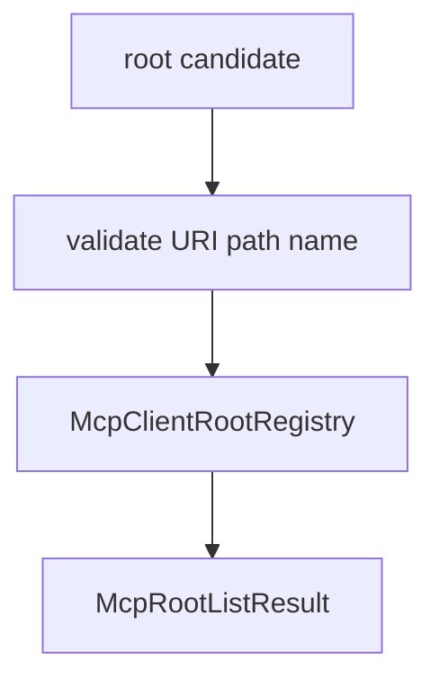

# M39-02 Client Root Registry Spec

## Purpose

Add a bounded root registry that validates explicit local file roots before they can be exposed through MCP client roots.

## Product Context

Contracts alone do not prove safety. The runtime needs one validation path that rejects ambiguous, secret-like, or out-of-scope roots before any MCP server can discover them.

## Scope

This spec delivers:

- `McpClientRootRegistry`
- workspace root admission helpers
- deterministic list output
- duplicate/conflict validation
- disabled root handling
- bounded diagnostics

Owned by later M39 specs:

- fixture roots/list behavior
- gateway diagnostics
- user-facing docs

## Architecture

The registry lives in `ruse-mcp` and accepts approved root candidates from runtime configuration or workspace setup code. It does not scan directories.



## Public Contracts

Expected APIs:

```rust
pub struct McpClientRootRegistry;
pub struct McpClientRootCandidate;
pub struct McpClientRootInspection;
```

The registry should provide:

- `register(candidate)`
- `list_result()`
- `inspection()`
- `is_empty()`

## State and Failure Handling

- Disabled candidates are retained for inspection but excluded from active `roots/list`.
- Missing local paths fail validation unless explicitly marked virtual in a later spec.
- Canonicalized roots must remain inside configured workspace boundaries.
- Duplicate identical roots are idempotent.
- Duplicate URI with conflicting names fails.

## Security and Privacy

- Registry registration never reads file contents.
- Diagnostics include root labels and safe URI summaries only.
- Secret-like names, URIs, and paths are rejected or redacted.
- Root registration does not mutate policy state or issue leases.

## Testing Strategy

- valid file root registration tests
- duplicate and conflicting duplicate tests
- disabled root tests
- out-of-workspace and traversal tests
- secret redaction diagnostics tests

## Acceptance Criteria

- `CARGO_TARGET_DIR=target/codex-m39 cargo test -p ruse-mcp mcp_client_root_registry`
- `CARGO_TARGET_DIR=target/codex-m39 cargo clippy -p ruse-mcp --all-targets -- -D warnings`

## Completion Signal

M39-02 is complete when explicit root candidates can be validated into deterministic active MCP root list results.
