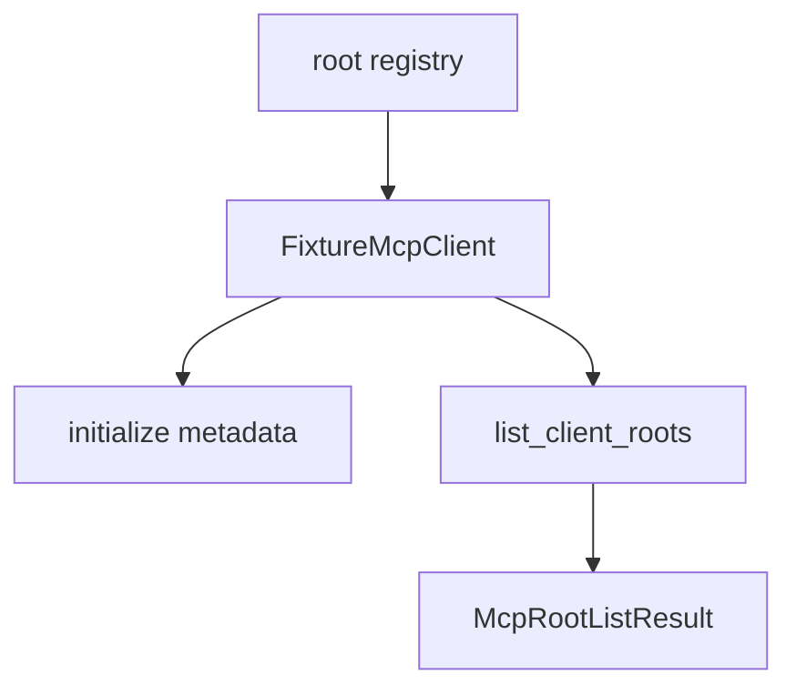

# M39-03 Client Session Roots Spec

## Purpose

Wire validated roots into MCP client fixture/session behavior so tests can model external servers requesting `roots/list`.

## Product Context

The existing `FixtureMcpClient` initializes servers, lists tools, and executes tool calls. M39 needs deterministic fixture support for client-provided roots before a real bidirectional transport exists.

## Scope

This spec delivers:

- client root provider trait or equivalent fixture method
- `FixtureMcpClient` root list storage per server
- root capability inclusion in client initialization metadata
- server-requested root list behavior in tests
- safe errors for disabled, unknown, or rootless servers

Owned by later M39 specs:

- gateway root diagnostics
- CLI/Desktop root management UX
- real transport handling for server-to-client requests

## Architecture

Root listing stays in `agent-mcp::client` and related root modules. The fixture models protocol semantics without adding a production stdio transport loop in this milestone.



## Public Contracts

Expected APIs:

```rust
#[async_trait]
pub trait McpClientRootProvider {
    async fn list_roots(&self, server_id: &McpServerId) -> Result<McpRootListResult, McpError>;
}
```

Fixture builder:

```rust
pub fn with_roots(self, server_id: McpServerId, roots: McpRootListResult) -> Self;
```

## State and Failure Handling

- Root listing for an unknown server returns `ServerNotFound`.
- Root listing for a configured server without roots returns an empty list.
- Disabled servers do not expose roots through health/gateway paths.
- Fixture results are cloned and deterministic.

## Security and Privacy

- Fixture diagnostics use existing MCP redaction helpers where available.
- Root data is never merged into tool inputs.
- Roots remain advisory metadata and do not bypass policy.

## Testing Strategy

- fixture root list success tests
- empty root list tests
- unknown server tests
- initialize capability metadata tests
- disabled server behavior tests through health/gateway setup

## Acceptance Criteria

- `CARGO_TARGET_DIR=target/codex-m39 cargo test -p agent-mcp mcp_client_session_roots`
- `CARGO_TARGET_DIR=target/codex-m39 cargo clippy -p agent-mcp --all-targets -- -D warnings`

## Completion Signal

M39-03 is complete when fixture MCP clients can expose validated client roots per server through typed root provider behavior.
