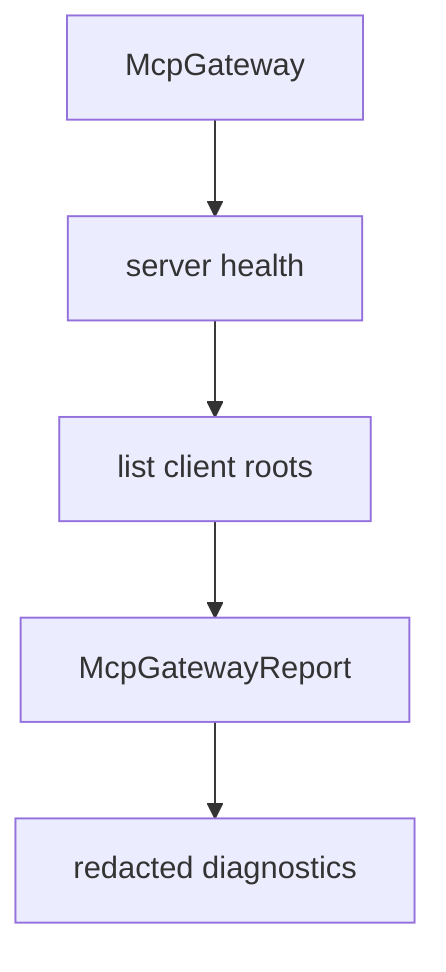

# M39-04 Gateway Roots Integration Spec

## Purpose

Surface MCP client root availability through gateway discovery reports and diagnostics without granting additional tool permissions.

## Product Context

Gateway users need to know whether an external MCP server was given local roots, especially when tool behavior depends on workspace context. This information must be inspectable and redacted like other extension diagnostics.

## Scope

This spec delivers:

- root-aware gateway report fields
- diagnostics for root provider failures
- health behavior that excludes roots for disabled/unhealthy servers
- deterministic report ordering
- root count and safe label summaries

Owned by later specs:

- CLI root management commands
- Desktop MCP root management UI
- dynamic root change notification delivery

## Architecture

`McpGateway` asks the client root provider for roots only after server health succeeds. Reports carry safe summaries; tool registration remains unchanged.



## Public Contracts

Expected report addition:

```rust
pub struct McpGatewayRootDescriptor {
    pub server_id: McpServerId,
    pub uri: String,
    pub name: Option<String>,
}
```

`McpGatewayReport` should include a root descriptor list or equivalent safe summary.

## State and Failure Handling

- Gateway root lookup runs only for enabled healthy servers.
- Root provider failures produce diagnostics and do not block tool discovery.
- Root diagnostics are sorted deterministically.
- Root descriptors do not include file contents or tool inputs.

## Security and Privacy

- Root data must not broaden local tool policy.
- Secret-like root names or diagnostic messages are redacted.
- Gateway reports avoid scanning child directories.
- The gateway never converts roots into automatic resource exports.

## Testing Strategy

- gateway report includes roots for healthy servers
- disabled/unhealthy servers have no root descriptors
- root provider errors become redacted diagnostics
- tool discovery behavior remains unchanged
- serialization snapshot tests for report shape

## Acceptance Criteria

- `CARGO_TARGET_DIR=target/codex-m39 cargo test -p agent-mcp mcp_gateway_roots`
- `CARGO_TARGET_DIR=target/codex-m39 cargo clippy -p agent-mcp --all-targets -- -D warnings`

## Completion Signal

M39-04 is complete when gateway discovery reports safe root metadata without changing tool registration or policy behavior.
