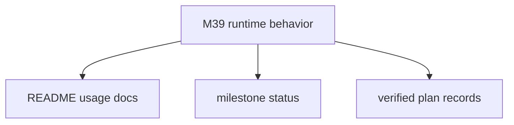

# M39-05 Hardening Docs Spec

## Purpose

Complete M39 documentation, milestone status, and final quality gate evidence.

## Product Context

After roots contracts, registry, fixture behavior, and gateway diagnostics exist, users and maintainers need a concise explanation of how MCP client roots work and what they do not authorize.

## Scope

This spec delivers:

- README docs for MCP client roots behavior
- milestone status updates
- plan checkboxes and verified command records
- final workspace quality gate

Owned by later milestones:

- full transport docs for bidirectional stdio roots requests
- Desktop root management UI docs
- remote MCP authorization docs

## Architecture

Documentation records root directionality and safety boundaries. Runtime logic remains in `agent-mcp`.

## State and Failure Handling

- M39 remains in progress until final workspace gates pass.
- Plan records must name exact commands run.
- README must not imply roots grant filesystem permissions.

## Security and Privacy

- Documentation must state that roots are advisory metadata.
- Examples must avoid secret-like paths or names.
- Diagnostics examples must stay redacted and bounded.

## Testing Strategy

- final focused M39 tests
- `git diff --check`
- `cargo fmt --all -- --check`
- `cargo xtask ci`

## Acceptance Criteria

- `CARGO_TARGET_DIR=target/codex-m39 cargo test -p agent-mcp mcp_client_root_contracts`
- `CARGO_TARGET_DIR=target/codex-m39 cargo test -p agent-mcp mcp_client_root_registry`
- `CARGO_TARGET_DIR=target/codex-m39 cargo test -p agent-mcp mcp_client_session_roots`
- `CARGO_TARGET_DIR=target/codex-m39 cargo test -p agent-mcp mcp_gateway_roots`
- `CARGO_TARGET_DIR=target/codex-m39 cargo xtask ci`

## Completion Signal

M39-05 is complete when docs and milestone status are updated, final verification passes, and the M39 completion commit exists.
