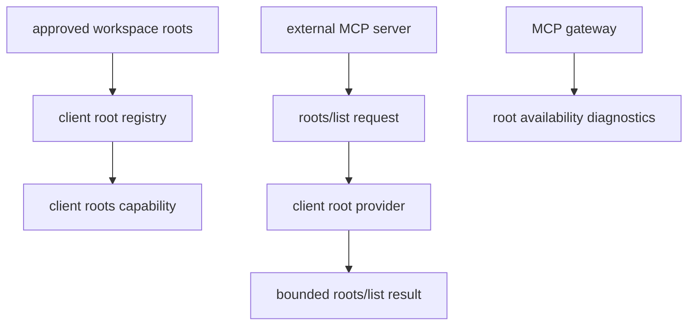

# M39 MCP Client Roots Runtime Spec

## Purpose

Let external MCP servers connected through `agent` as an MCP client discover explicit, bounded workspace roots through the client-side roots capability.

## Product Context

M30-M38 made `agent` a useful local MCP server. M39 returns to the MCP client and gateway side from PRD 5.11: external MCP servers often need to understand which local folders are in scope, but those roots must be explicit, inspectable, and unable to broaden local policy or sandbox permissions.

The current MCP roots protocol is client-owned: servers request roots from clients. M39 therefore implements local client root provider contracts and gateway wiring, not a new `agent` MCP server export method.

## Scope

This milestone delivers:

- typed MCP root contracts and list result serde shape
- a bounded client root registry with URI/path validation
- client capability metadata for roots support
- fixture client behavior for server-requested root listing
- gateway diagnostics that expose root availability without leaking paths beyond approved roots
- hardening docs and final M39 verification

Owned by later milestones:

- real bidirectional stdio transport handling for server-to-client requests
- remote HTTP MCP root negotiation
- dynamic Desktop project switch notifications beyond typed contracts
- MCP sampling, elicitation, and logging
- roots backed by arbitrary user file pickers or cloud workspaces

## Architecture

`ruse-mcp` owns root contracts, registry validation, fixture behavior, and gateway diagnostics. `ruse-cli` and Desktop remain presentation clients and do not own root policy. Root declarations are advisory protocol metadata; actual filesystem access remains controlled by `ruse-policy`, `ruse-sandbox`, and tool execution boundaries.

## State and Failure Handling

- Root listing is unavailable until a client session has initialized with roots support.
- Disabled or unhealthy servers do not receive root data.
- Invalid root names, non-file URIs, duplicate URIs, missing roots, and paths outside approved workspace boundaries are rejected before registration.
- Root list changes are represented as typed notifications in M39, but runtime delivery is reserved for a later transport slice.
- Root listing has no side effects and never issues permission leases.

## Security and Privacy

- Roots are explicit public metadata for a configured MCP server.
- A root URI never grants read/write permission by itself.
- Secret-like names and diagnostics are rejected or redacted.
- Path normalization must avoid traversal, symlink surprise where the platform can canonicalize, duplicate aliases, and raw environment expansion.
- Gateway reports count and label roots safely; they do not print arbitrary filesystem scans.

## Testing Strategy

- serde tests for root contracts and list result shape
- registry tests for validation, dedupe, ordering, disabled roots, and secret redaction
- fixture client tests for roots capability and `roots/list` behavior
- gateway tests for root-aware diagnostics and unhealthy/disabled server behavior
- CLI/readme hardening docs checks through existing workspace gates

## Acceptance Criteria

- `CARGO_TARGET_DIR=target/codex-m39 cargo test -p ruse-mcp mcp_client_root_contracts`
- `CARGO_TARGET_DIR=target/codex-m39 cargo test -p ruse-mcp mcp_client_root_registry`
- `CARGO_TARGET_DIR=target/codex-m39 cargo test -p ruse-mcp mcp_client_session_roots`
- `CARGO_TARGET_DIR=target/codex-m39 cargo test -p ruse-mcp mcp_gateway_roots`
- `CARGO_TARGET_DIR=target/codex-m39 cargo xtask ci`

## Completion Signal

M39 is complete when explicit MCP client roots can be registered, listed through typed fixture client behavior, surfaced in gateway diagnostics, documented, and verified through the final quality gate.
