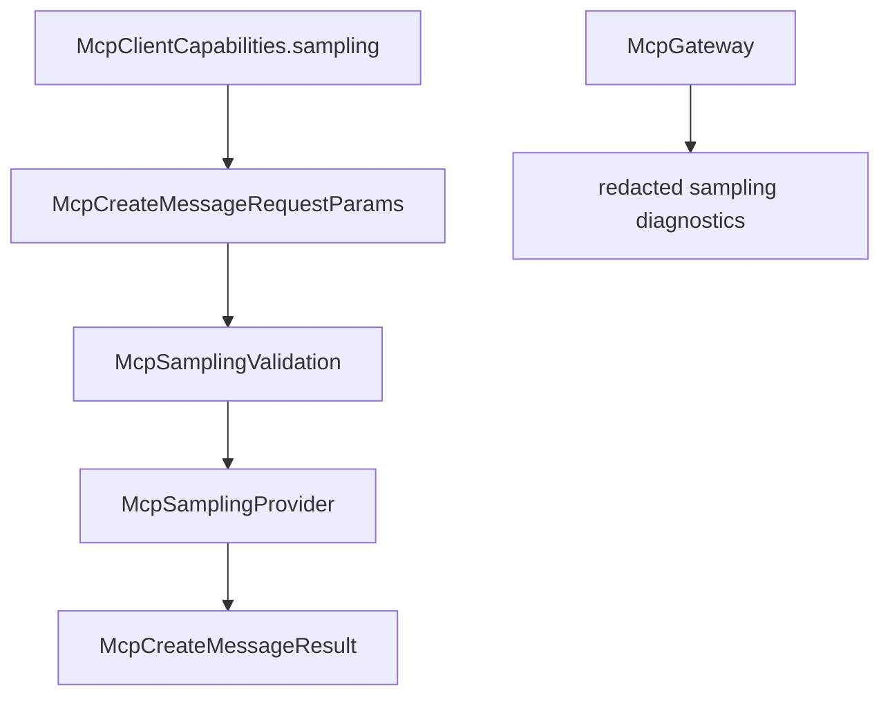

# M40-00 MCP Sampling Technical Design Spec

## Purpose

Define how `agent` accepts MCP server sampling requests as client-owned model requests without giving external servers direct access to local model credentials, tools, context, or approval bypasses.

## Product Context

M39 established explicit client roots for external MCP servers. Sampling is the next client-side MCP primitive because servers may ask the client to perform an LLM generation. This is more sensitive than roots: prompts and responses may contain private data, model calls may incur cost, and server-requested tools could overlap with local tool policy. M40 therefore starts with a safe typed foundation before any live model or UI approval integration.

## Scope

This spec delivers:

- protocol direction decision: sampling is handled as a server-to-client request through `agent-mcp`
- capability metadata for basic sampling, with future fields for tool and context support
- create-message request/result contracts and redaction boundaries
- safe-subset validation rules for M40
- fixture provider behavior and gateway diagnostics

Owned by implementation slices:

- concrete Rust contracts
- validation helpers and diagnostics
- fixture client/session behavior
- gateway reporting
- README and milestone hardening docs

## Architecture

Sampling data lives in `agent-mcp` because it is MCP protocol state. The runtime treats model access as an internal capability that will later be bridged through `agent-model`, `agent-policy`, and UI approval. M40 does not let an MCP server select a provider credential or execute local tools.



## Public Contracts

Expected contracts:

```rust
pub struct McpClientSamplingCapability;
pub struct McpSamplingMessage;
pub enum McpSamplingContent;
pub struct McpModelHint;
pub struct McpModelPreferences;
pub enum McpSamplingIncludeContext;
pub struct McpCreateMessageRequestParams;
pub struct McpCreateMessageResult;
pub trait McpSamplingProvider;
```

Basic capability shape:

```json
{
  "sampling": {}
}
```

M40 may serialize `sampling.tools` and `sampling.context` capability fields when explicitly constructed, but runtime validation rejects requests that require those fields until later implementation slices opt in.

## State and Failure Handling

- Sampling requests are read from protocol frames or fixture calls and converted into typed contracts before validation.
- Validation produces a redacted diagnostic code and message, not raw prompt text.
- `maxTokens` must be positive and bounded by a local maximum.
- `includeContext` defaults to `none`; `thisServer` and `allServers` are rejected in M40.
- `tools` and `toolChoice` are rejected in M40 even if represented in contract metadata.
- Sampling provider failures are recoverable diagnostics for gateway discovery paths.

## Security and Privacy

- Prompt text, media payloads, metadata, and generated response text are sensitive.
- Gateway reports must not include raw `messages`, `systemPrompt`, media data, tool inputs, or provider metadata.
- Model hints are advisory and redacted when exposed in diagnostics.
- M40 does not issue permission leases and does not execute local tools.

## Testing Strategy

- contract tests for serde-compatible request and response shape
- validation tests for capability-gated fields and bounded values
- fixture provider tests for deterministic responses and errors
- gateway report tests for redaction and non-blocking diagnostics

## Acceptance Criteria

- M40 slice specs and plans are complete.
- M40-01 can start from concrete contracts and focused test targets.

## Completion Signal

This design is complete when M40 slice docs exist and the milestone index points to M40-01.
