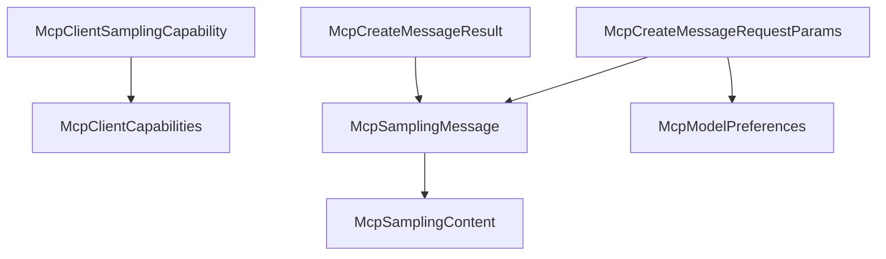

# M40-01 Sampling Contracts Spec

## Purpose

Add serializable MCP sampling contracts for basic `sampling/createMessage` requests and results.

## Product Context

M40 begins with stable protocol data types before adding validation, fixture behavior, or gateway usage. The contracts must be durable enough for later live model integration while preserving the M40 safe subset.

## Scope

This spec delivers:

- `McpClientSamplingCapability`
- `McpSamplingContentList`
- `McpSamplingMessage`
- `McpSamplingContent` with text, image, audio, tool use, and tool result variants
- `McpModelHint` and `McpModelPreferences`
- `McpSamplingIncludeContext`
- `McpCreateMessageRequestParams`
- `McpCreateMessageResult`
- serde-compatible `sampling/createMessage` request parameter and result shapes

Owned by later M40 specs:

- safe-subset validation and diagnostics
- fixture client sampling behavior
- gateway sampling reports
- hardening docs

## Architecture

Contracts live in `agent-mcp`, independent from CLI and Desktop presentation. The module should stay protocol-focused and not depend on `agent-model`.



## Public Contracts

Expected contracts:

```rust
pub struct McpClientSamplingCapability {
    pub tools: bool,
    pub context: bool,
}

pub struct McpSamplingContentList {
    pub content: Vec<McpSamplingContent>,
}

pub struct McpSamplingMessage {
    pub role: McpSamplingRole,
    pub content: McpSamplingContentList,
}

pub enum McpSamplingContent {
    Text { text: String },
    Image { data: String, mime_type: String },
    Audio { data: String, mime_type: String },
    ToolUse { id: String, name: String, input: serde_json::Value },
    ToolResult { tool_use_id: String, content: Vec<McpSamplingContent> },
}

pub struct McpCreateMessageRequestParams {
    pub messages: Vec<McpSamplingMessage>,
    pub model_preferences: Option<McpModelPreferences>,
    pub system_prompt: Option<String>,
    pub include_context: McpSamplingIncludeContext,
    pub temperature: Option<f32>,
    pub max_tokens: u32,
    pub stop_sequences: Vec<String>,
    pub metadata: Option<serde_json::Value>,
    pub tools: Vec<serde_json::Value>,
    pub tool_choice: Option<serde_json::Value>,
}
```

Serde must use MCP-compatible field names: `modelPreferences`, `systemPrompt`, `includeContext`, `maxTokens`, and `stopSequences`.

## State and Failure Handling

- Constructors normalize single-content and list-content inputs into a stable internal list.
- Optional fields are omitted when absent or empty where the protocol allows.
- Result `stopReason` is optional and bounded.
- Contract constructors reject empty role/content fields only where type shape cannot represent valid protocol data; deeper policy validation is owned by M40-02.

## Security and Privacy

- Contracts do not log prompt text or media payloads.
- Secret-like text rejection for public fields is limited to model names, stop reasons, MIME types, tool names, and diagnostic-safe labels; raw prompt content is sensitive data and must be handled by later redaction paths rather than treated as a public field.
- No model call, tool call, or permission lease occurs in this slice.

## Testing Strategy

- capability serde shape tests for `{ "sampling": {} }`, `sampling.tools`, and `sampling.context`
- request serde shape tests for basic text messages and model preferences
- result serde shape tests for assistant text results and stop reasons
- content shape tests for text, image, audio, tool use, and tool result variants
- constructor tests for single-content normalization into the internal content list

## Acceptance Criteria

- `CARGO_TARGET_DIR=target/codex-m40 cargo test -p agent-mcp mcp_sampling_contracts`
- `CARGO_TARGET_DIR=target/codex-m40 cargo clippy -p agent-mcp --all-targets -- -D warnings`

## Completion Signal

M40-01 is complete when sampling contracts have stable serde behavior and focused tests.
