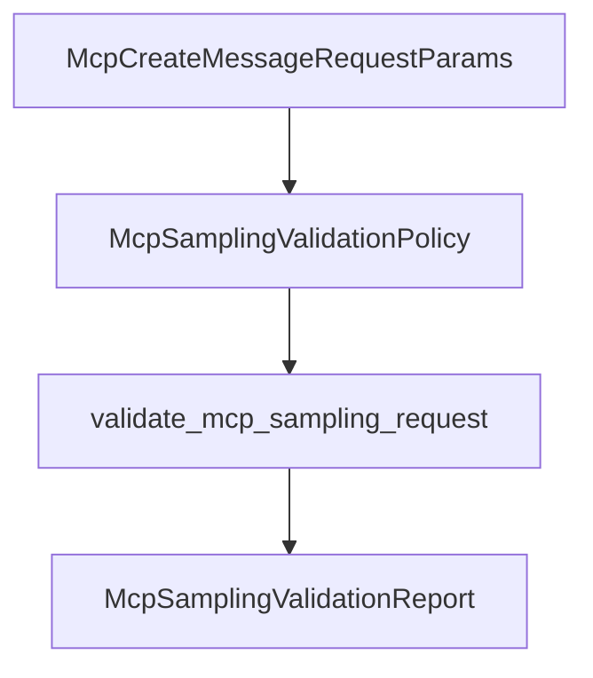

# M40-02 Sampling Validation Spec

## Purpose

Validate MCP sampling requests before provider execution so unsupported capabilities and unsafe prompt shapes fail with redacted diagnostics.

## Product Context

M40-01 adds protocol contracts. M40-02 turns those contracts into an explicit M40 safe subset: basic model sampling only, no server-requested tools, and no soft-deprecated cross-server context inclusion.

## Scope

This spec delivers:

- `McpSamplingValidationPolicy`
- `McpSamplingValidationReport`
- `validate_mcp_sampling_request`
- bounds for `maxTokens`, text length, media payload length, MIME text, model hints, stop sequences, and metadata diagnostics
- rejection codes for unsupported tools, unsupported context inclusion, invalid roles, invalid content, invalid tool-result balance, and oversized requests

Owned by later M40 specs:

- fixture provider behavior
- gateway diagnostics using validation reports
- README hardening docs

## Architecture

Validation lives in `agent-mcp` next to sampling contracts. It has no dependency on `agent-policy`; this slice only validates MCP protocol shape and M40 capability support. Permission and approval decisions remain later runtime work.



## Public Contracts

Expected contracts:

```rust
pub struct McpSamplingValidationPolicy {
    pub allow_tools: bool,
    pub allow_context: bool,
    pub max_tokens_limit: u32,
    pub max_text_chars: usize,
    pub max_media_bytes_base64_chars: usize,
}

pub struct McpSamplingValidationReport {
    pub accepted: bool,
    pub diagnostics: Vec<McpSamplingDiagnostic>,
}

pub enum McpSamplingDiagnosticSeverity {
    Info,
    Warning,
    Error,
}

pub struct McpSamplingDiagnostic {
    pub code: String,
    pub severity: McpSamplingDiagnosticSeverity,
    pub message: String,
}

pub fn validate_mcp_sampling_request(
    request: &McpCreateMessageRequestParams,
    policy: &McpSamplingValidationPolicy,
) -> McpSamplingValidationReport;
```

## State and Failure Handling

- Empty message lists are rejected.
- `maxTokens` of `0` and values above the local policy bound are rejected.
- `includeContext` values `thisServer` and `allServers` are rejected unless `allow_context` is true.
- Non-empty `tools` or any `toolChoice` are rejected unless `allow_tools` is true.
- Tool result messages must consist only of tool result content.
- Assistant tool use blocks must be followed by a user message with matching tool result IDs before any other message.
- Validation errors do not mutate request state. Callers convert rejected reports into `McpError::InvalidServerRequest` before provider execution.

## Security and Privacy

- Diagnostics must not include raw prompt text, system prompt text, media data, tool input JSON, or provider metadata.
- Rejection messages may include counts, bounded numeric limits, and redacted public labels.
- Validation does not inspect environment variables, files, credentials, or network state.

## Testing Strategy

- accepted basic text request test
- rejected empty messages and invalid `maxTokens` tests
- rejected unsupported `tools`, `toolChoice`, and context inclusion tests
- rejected mixed tool result message test
- rejected unmatched tool use/tool result sequence test
- diagnostic redaction test with secret-like prompt content

## Acceptance Criteria

- `CARGO_TARGET_DIR=target/codex-m40 cargo test -p agent-mcp mcp_sampling_validation`
- `CARGO_TARGET_DIR=target/codex-m40 cargo clippy -p agent-mcp --all-targets -- -D warnings`

## Completion Signal

M40-02 is complete when unsafe or unsupported sampling requests fail before provider execution with redacted diagnostics.
