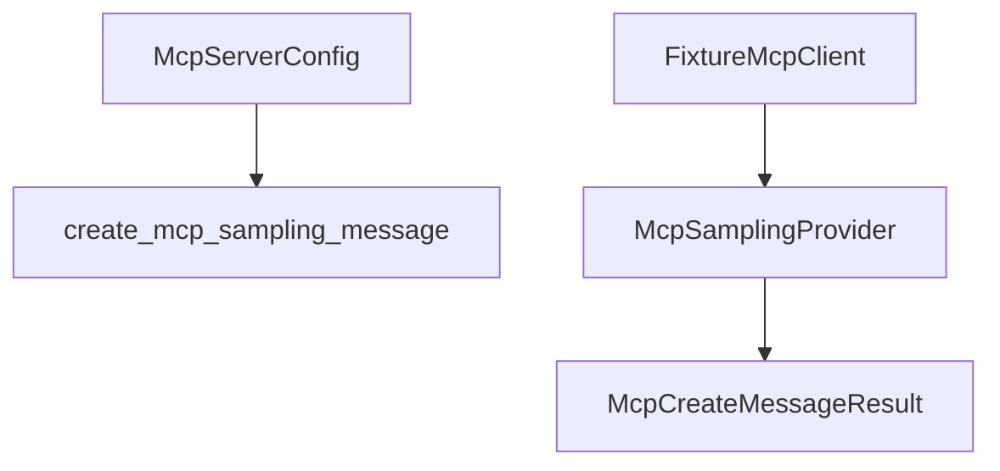

# M40-03 Client Session Sampling Spec

## Purpose

Add deterministic client/session fixture behavior for server-requested MCP sampling.

## Product Context

M40-01 and M40-02 define and validate sampling requests. M40-03 gives tests and later gateway code a stable `McpSamplingProvider` boundary before any live model or bidirectional transport integration.

## Scope

This spec delivers:

- `McpSamplingProvider` trait
- `FixtureMcpClient::with_sampling_result`
- `FixtureMcpClient::with_sampling_error`
- `FixtureMcpClient::create_message`
- capability reporting for basic sampling
- helper function for disabled server behavior

Owned by later M40 specs:

- gateway sampling diagnostics
- docs and final hardening

## Architecture

The provider trait extends the MCP client fixture boundary without changing tool execution. Sampling is a separate server-to-client request path and must not be conflated with `McpGatewayClient::call_tool`.



## Public Contracts

Expected trait:

```rust
#[async_trait]
pub trait McpSamplingProvider: Send + Sync {
    async fn create_message(
        &self,
        server_id: &McpServerId,
        request: McpCreateMessageRequestParams,
    ) -> Result<McpCreateMessageResult, McpError>;
}
```

Expected helper:

```rust
pub async fn create_mcp_sampling_message(
    provider: &dyn McpSamplingProvider,
    config: &McpServerConfig,
    request: McpCreateMessageRequestParams,
) -> Result<McpCreateMessageResult, McpError>;
```

## State and Failure Handling

- Unknown servers fail with `McpError::ServerNotFound`.
- Disabled server configs reject sampling before provider execution.
- Fixture sampling results are keyed by server ID and deterministic request labels or a single default response per server.
- Fixture sampling errors are cloned and redacted through existing `McpError` display paths.
- Sampling call counts are tracked separately from tool call counts.

## Security and Privacy

- Fixture call tracking must not store raw prompt text.
- Helper errors must not echo prompt or response content.
- Capability metadata indicates only whether sampling is available, not model credentials.

## Testing Strategy

- fixture success test for a configured server
- fixture unknown server test
- disabled server helper test
- validation-before-provider test using unsupported tools
- call count test that does not retain prompt text
- capability shape test combining roots and sampling

## Acceptance Criteria

- `CARGO_TARGET_DIR=target/codex-m40 cargo test -p ruse-mcp mcp_client_session_sampling`
- `CARGO_TARGET_DIR=target/codex-m40 cargo clippy -p ruse-mcp --all-targets -- -D warnings`

## Completion Signal

M40-03 is complete when tests can deterministically exercise `sampling/createMessage` without live model calls or prompt leakage.
