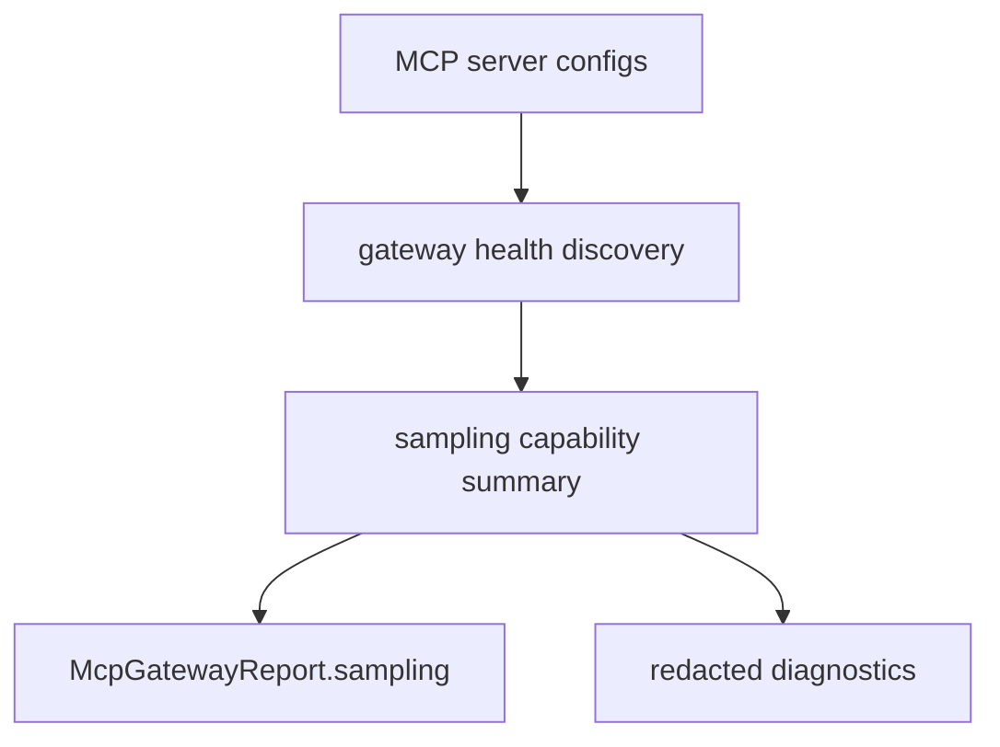

# M40-04 Gateway Sampling Diagnostics Spec

## Purpose

Surface MCP sampling availability and failures in gateway reports without leaking prompts, responses, media payloads, model credentials, or provider metadata.

## Product Context

Gateway diagnostics already report tools and roots. Sampling is another client-side capability exposed to external MCP servers, so operators need to inspect which servers can request sampling and why a sampling path is unavailable.

## Scope

This spec delivers:

- `McpGatewaySamplingDescriptor`
- `McpGatewayReport.sampling`
- redacted sampling discovery diagnostics for enabled healthy servers
- non-blocking handling when sampling availability or fixture diagnostics fail

Owned by later specs:

- CLI commands that actively invoke sampling
- Desktop approval UI for sampling requests
- live model invocation traces

## Architecture

The gateway report summarizes capability availability; it does not execute sampling during tool discovery. Sampling execution remains explicit through provider methods and future transport handling.



## Public Contracts

Expected descriptor:

```rust
pub struct McpGatewaySamplingDescriptor {
    pub server_id: McpServerId,
    pub available: bool,
    pub tools_supported: bool,
    pub context_supported: bool,
    pub message: String,
}
```

## State and Failure Handling

- Disabled, unhealthy, and unknown servers report no active sampling availability.
- Healthy servers with a sampling capability produce one descriptor.
- Sampling validation/provider errors are diagnostic-only during gateway discovery and do not block tool registration.
- Report sorting is deterministic by server ID.

## Security and Privacy

- Gateway sampling descriptors never include request messages, system prompts, response content, media data, provider metadata, or secret names.
- Messages are bounded and redacted.
- Sampling availability does not imply model permission approval.

## Testing Strategy

- reports sampling for healthy enabled servers with sampling capability
- excludes disabled and unhealthy servers
- redacts sampling errors and does not block tool discovery
- keeps report ordering deterministic
- serializes `McpGatewayReport.sampling` in a stable JSON shape

## Acceptance Criteria

- `CARGO_TARGET_DIR=target/codex-m40 cargo test -p ruse-mcp mcp_gateway_sampling`
- `CARGO_TARGET_DIR=target/codex-m40 cargo clippy -p ruse-mcp --all-targets -- -D warnings`

## Completion Signal

M40-04 is complete when gateway reports expose safe sampling availability diagnostics without executing sampling or leaking prompts.
