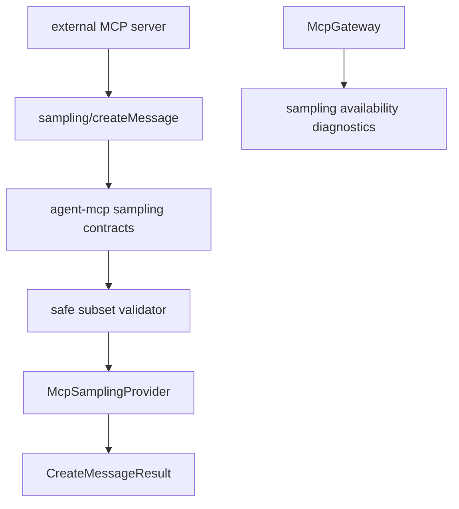

# M40 MCP Sampling Runtime Spec

## Purpose

Allow external MCP servers connected through `agent` client or gateway flows to request bounded model sampling through `sampling/createMessage`, while `agent` keeps control over model choice, approval, policy, redaction, and audit metadata.

## Product Context

M30-M39 made `agent` useful on both sides of MCP server/export and client roots flows. The official MCP 2025-11-25 client sampling feature lets servers request LLM generations through clients without server-owned API keys, but it also introduces a sensitive nested model-call path. M40 implements a safe runtime foundation for PRD 5.2, 5.4, 5.11, and 5.12 without bypassing local model policy or UI approval boundaries.

Protocol assumptions were checked against:

- https://modelcontextprotocol.io/specification/2025-11-25/client/sampling
- https://modelcontextprotocol.io/specification/2025-11-25/schema

## Scope

This milestone delivers:

- typed MCP sampling request, message, content, model preference, and result contracts
- client sampling capability metadata in `McpClientCapabilities`
- request validation for the M40 safe subset: text/image/audio content contracts, no server-requested tools by default, no soft-deprecated context inclusion unless explicitly supported later
- a `McpSamplingProvider` fixture path for deterministic `sampling/createMessage` behavior
- gateway sampling diagnostics that report availability and rejected capability requests without leaking prompt text
- hardening docs and final M40 verification

Owned by later milestones:

- real bidirectional stdio transport dispatch for server-to-client sampling requests
- live `agent-model` invocation from MCP sampling requests
- human approval UI for sampling prompt and response review
- tool-enabled sampling loops using `sampling.tools`
- task-augmented sampling, MCP elicitation, MCP logging, and MCP task utilities
- provider-specific multimodal conversion beyond stable protocol contracts

## Architecture

`agent-mcp` owns protocol contracts, validation, fixture behavior, and gateway diagnostics. `agent-model`, `agent-policy`, CLI, TUI, and Desktop are consumers of typed sampling state in later slices; they do not own MCP wire contracts.

## State and Failure Handling

- Sampling is unavailable until the client declares the `sampling` capability for a configured server flow.
- Requests with `tools` or `toolChoice` fail in M40 unless the client explicitly declares tool-enabled sampling in a later spec.
- Requests with `includeContext` values other than `none` fail in M40; this avoids the soft-deprecated context path and prevents accidental cross-server context exposure.
- Invalid roles, empty message lists, empty text blocks, malformed media MIME data, invalid `maxTokens`, secret-like metadata, and oversized prompt fields fail before provider execution.
- Provider errors are redacted and become diagnostics; they do not poison tool discovery or root discovery.
- Sampling has no filesystem, command, Git, browser, Desktop, or secret permission grant by itself.

## Security and Privacy

- Sampling prompts and generated responses are sensitive content and must not appear in gateway reports or diagnostics.
- Diagnostics may include counts, model names after redaction, stop reasons after redaction, and high-level rejection codes.
- Server model preferences are advisory. `agent` may ignore requested hints and choose a locally allowed model.
- M40 does not expose local tools to server-requested sampling. Tool use remains governed by existing local tool policy and later explicit sampling tool specs.
- Sampling results remain auditable through typed summaries without storing raw prompt text in public reports.

## Testing Strategy

- serde shape tests for client sampling capability, create-message params, messages, content, model preferences, and results
- validation tests for supported content, unsupported tools, unsupported context inclusion, `maxTokens` bounds, role constraints, and tool result balancing guardrails
- fixture provider tests for deterministic success, unknown server failure, disabled server empty/unavailable behavior, and redacted provider errors
- gateway tests for sampling availability diagnostics and non-blocking failures
- documentation and workspace gates through `cargo xtask ci`

## Acceptance Criteria

- `CARGO_TARGET_DIR=target/codex-m40 cargo test -p agent-mcp mcp_sampling_contracts`
- `CARGO_TARGET_DIR=target/codex-m40 cargo test -p agent-mcp mcp_sampling_validation`
- `CARGO_TARGET_DIR=target/codex-m40 cargo test -p agent-mcp mcp_client_session_sampling`
- `CARGO_TARGET_DIR=target/codex-m40 cargo test -p agent-mcp mcp_gateway_sampling`
- `CARGO_TARGET_DIR=target/codex-m40 cargo xtask ci`

## Completion Signal

M40 is complete when `agent-mcp` can represent, validate, fixture-execute, and diagnose safe MCP sampling requests without leaking prompt content or weakening local model/tool policy.
