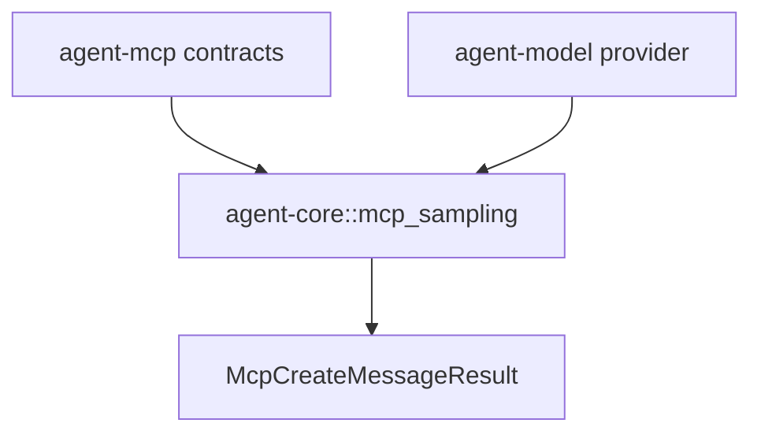

# M41-00 MCP Sampling Model Bridge Technical Design Spec

## Purpose

Define the bridge from MCP sampling requests to local model providers while keeping MCP protocol, model execution, redaction, and permission boundaries separate.

## Product Context

M40 ended at deterministic fixture behavior. M41 introduces local model execution for the safe subset, which is the smallest useful runtime step before transport dispatch or UI approval.

## Scope

This spec delivers:

- crate boundary decision: `agent-core` owns MCP-to-model bridge logic
- text-only mapping from MCP sampling messages to `ModelRequest.messages`
- local provider/model selection through bridge config
- provider-backed `McpSamplingProvider` design
- redacted error and unsupported-path strategy

Owned by implementation slices:

- concrete mapping contracts
- model-backed provider execution
- redaction helpers
- guardrail tests and docs

## Architecture

`agent-core` gains `mcp_sampling.rs` and a normal dependency on `agent-mcp`. The bridge consumes `agent_mcp` request contracts and `agent_model` providers. `agent-mcp` does not depend on `agent-model`.



## Public Contracts

```rust
pub struct McpSamplingModelBridgeConfig {
    pub provider: String,
    pub model: String,
}

pub struct McpSamplingModelBridgeIds {
    pub conversation_id: ConversationId,
    pub turn_id: TurnId,
    pub correlation_id: CorrelationId,
}

pub enum McpSamplingModelBridgeError {
    InvalidRequest(String),
    UnsupportedContent(String),
    Model(String),
}
```

## State and Failure Handling

- Mapping is pure and deterministic.
- Provider execution validates before streaming.
- Unsupported MCP content is rejected before model execution.
- Model stream errors are redacted.
- Empty model output still returns a valid assistant text result with an empty string.

## Security and Privacy

- Error strings expose codes and safe field names, not prompt text.
- Local provider/model config overrides server hints.
- No tool calls from the model stream are accepted.

## Testing Strategy

- request mapping unit tests in `agent-core`
- provider integration tests with `FakeModelProvider`
- redaction and guardrail tests for unsafe paths

## Acceptance Criteria

- M41 slice specs and plans exist.
- Milestone index points active work to M41-01.

## Completion Signal

This design is complete when M41-01 can start from concrete contracts and focused test targets.
