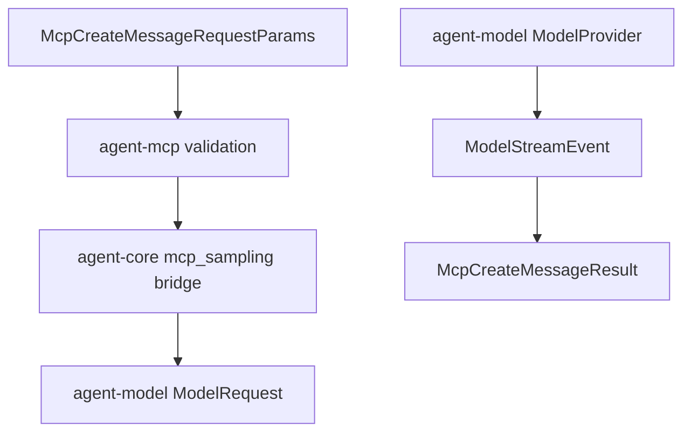

# M41 MCP Sampling Model Bridge Runtime Spec

## Purpose

Bridge validated MCP `sampling/createMessage` requests into controlled `agent-model` provider calls without giving external MCP servers model credentials, local tools, approval bypasses, or raw diagnostic surfaces.

## Product Context

M40 made MCP sampling representable, validated, fixture-executable, and visible in gateway reports. M41 is the next narrow runtime step: use the existing `agent-model` abstraction to execute safe text-only sampling requests through a locally selected provider. This advances PRD 5.2, 5.4, 5.11, and 5.12 while preserving the M40 boundary that sampling is not a permission grant.

## Scope

This milestone delivers:

- an `agent-core` bridge module that maps safe MCP sampling requests to `agent-model::ModelRequest`
- a deterministic `McpSamplingProvider` implementation backed by `agent-model::ModelProvider`
- redacted bridge diagnostics for unsupported content and provider failures
- guardrails that reject server-requested tools, context inclusion, tool-call stream events, and unsupported media conversion
- README and milestone hardening docs with final verification evidence

Owned by later milestones:

- bidirectional stdio transport dispatch for server-to-client sampling frames
- interactive approval UI for sampling prompts and responses
- Desktop prompt/response review surfaces
- multimodal model conversion for image/audio content
- tool-enabled sampling loops
- task-augmented sampling, MCP elicitation, MCP logging, and MCP task utilities

## Architecture

`agent-mcp` remains the MCP protocol owner. `agent-core` owns the bridge because it already depends on `agent-model` and can enforce runtime policy boundaries before model execution. `agent-model` providers do not learn about MCP; they receive ordinary `ModelRequest` values.



## Public Contracts

Expected core contracts:

```rust
pub struct McpSamplingModelBridgeConfig {
    pub provider: String,
    pub model: String,
}

pub struct McpSamplingModelBridgeIds {
    pub conversation_id: ConversationId,
    pub turn_id: TurnId,
    pub correlation_id: CorrelationId,
}

pub enum McpSamplingModelBridgeError;

pub fn build_mcp_sampling_model_request(
    request: &McpCreateMessageRequestParams,
    config: &McpSamplingModelBridgeConfig,
    ids: McpSamplingModelBridgeIds,
) -> Result<ModelRequest, McpSamplingModelBridgeError>;
```

Expected provider:

```rust
pub struct McpModelSamplingProvider<P> {
    pub provider: P,
    pub config: McpSamplingModelBridgeConfig,
}
```

The provider implements `agent_mcp::McpSamplingProvider` and returns an MCP assistant text result by concatenating model delta events.

## State and Failure Handling

- Disabled server configs still reject before bridge execution through the M40 helper.
- M41 validates with `McpSamplingValidationPolicy::default()` before building a model request.
- Text messages become bounded model request strings with role labels and optional system prompt prefix.
- Image, audio, tool-use, and tool-result content are rejected by the model bridge until later multimodal or tool-enabled milestones.
- Model provider errors are converted to redacted bridge errors and then to `McpError::Client` or `McpError::InvalidServerRequest`.
- Model stream tool-call events are rejected because M41 does not grant tools to server-requested sampling.

## Security and Privacy

- Raw prompt text and model response text are not included in errors, gateway reports, or public diagnostics.
- Server model hints remain advisory; local bridge config chooses provider and model.
- Sampling does not grant filesystem, command, Git, browser, Desktop, local secret, network, or local tool permissions.
- Provider credentials stay inside `agent-model` configuration and secret resolution.

## Testing Strategy

- mapping tests for text-only messages, system prompts, local provider/model selection, and metadata IDs
- rejection tests for media, tool content, unsupported context, and server-requested tools
- provider tests using `FakeModelProvider` to produce deterministic MCP results
- redaction tests ensuring bridge errors do not leak prompt text, secret-like values, or provider response text
- focused M41 tests plus final workspace gate through `cargo xtask ci`

## Acceptance Criteria

- `CARGO_TARGET_DIR=target/codex-m41 cargo test -p agent-core mcp_sampling_model_mapping`
- `CARGO_TARGET_DIR=target/codex-m41 cargo test -p agent-core mcp_sampling_model_provider`
- `CARGO_TARGET_DIR=target/codex-m41 cargo test -p agent-core mcp_sampling_model_redaction`
- `CARGO_TARGET_DIR=target/codex-m41 cargo xtask ci`

## Completion Signal

M41 is complete when safe text-only MCP sampling can execute through an `agent-model` provider from `agent-core`, return typed MCP sampling results, reject unsupported paths safely, and pass focused and workspace gates.
