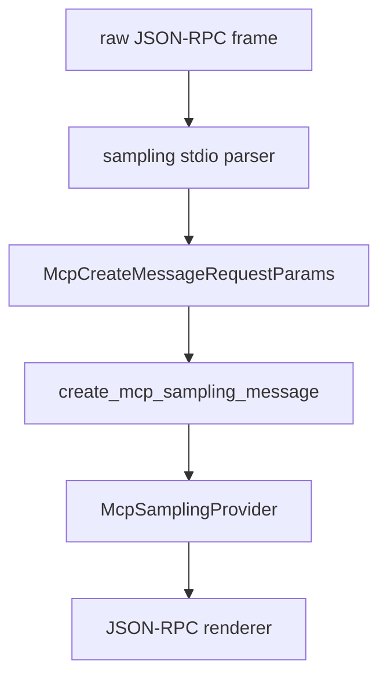

# M42-00 MCP Sampling Stdio Dispatch Technical Design Spec

## Purpose

Define the runtime boundary for dispatching MCP `sampling/createMessage` JSON-RPC frames from an external MCP server into the local sampling provider path.

## Product Context

M42 follows M41 by moving from provider-backed sampling calls to protocol-level sampling dispatch. The milestone remains a fixture runtime, not a spawned MCP process client.

## Scope

This spec delivers:

- crate ownership for sampling stdio dispatch
- JSON-RPC request, success, and failure flow
- validation and provider invocation order
- redaction and trace boundaries
- slice decomposition for M42 implementation

Owned by later specs:

- real bidirectional process transport
- approval UI
- multimodal and tool-enabled sampling

## Architecture

`agent-mcp` owns a new sampling stdio dispatch module. It reuses existing JSON-RPC envelope types, sampling contracts, server config, and `McpSamplingProvider`. The module does not depend on `agent-core`.



## Public Contracts

The technical design expects:

```rust
pub const MCP_SAMPLING_CREATE_MESSAGE_METHOD: &str = "sampling/createMessage";

pub fn handle_mcp_sampling_stdio_frame(
    provider: &dyn McpSamplingProvider,
    config: &McpServerConfig,
    frame: &str,
) -> String;
```

## State and Failure Handling

- The dispatcher is stateless and deterministic.
- Request `id` is preserved in success and failure responses.
- Notifications without `id` return no response.
- Invalid frames use JSON-RPC error codes consistent with existing server stdio fixtures.
- Sampling validation happens before provider invocation.

## Security and Privacy

- Diagnostics are bounded and redacted.
- Prompt text, system prompts, provider errors, and secret-like values never appear in public errors.

## Testing Strategy

- contract tests for method constant and envelope shape
- dispatcher tests for success and failure paths
- redaction tests for unsafe frame and provider diagnostics

## Acceptance Criteria

- M42 slice specs and plans exist.
- `docs/milestones/README.md` references M42 and active M42-01 work.

## Completion Signal

The technical design is complete when the M42 milestone can be implemented slice-by-slice without adding new crate ownership ambiguity.
