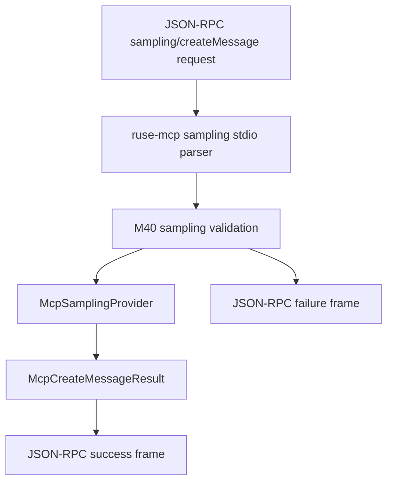

# M42 MCP Sampling Stdio Dispatch Runtime Spec

## Purpose

Dispatch MCP server-initiated `sampling/createMessage` JSON-RPC request frames through the local sampling provider path, returning deterministic JSON-RPC success or failure frames without exposing prompts, responses, provider metadata, credentials, or tool permissions.

## Product Context

M40 introduced typed MCP sampling contracts and validation. M41 connected safe text-only sampling to local `ruse-model` providers. M42 adds the next protocol step: a fixture-grade stdio dispatch path for server-to-client sampling request frames. This keeps progress toward full MCP client transport support while preserving the boundary that sampling is a controlled model call, not a grant of tools, context, or secrets.

## Scope

This milestone delivers:

- sampling JSON-RPC frame contracts for server-to-client `sampling/createMessage`
- a deterministic dispatcher that parses one sampling request frame, invokes `McpSamplingProvider`, and renders a JSON-RPC response frame
- validation-before-provider behavior using the M40 safe subset
- redacted JSON-RPC errors and trace-safe summaries for invalid frames and provider failures
- README and milestone docs with final verification evidence

Owned by later milestones:

- spawned stdio process client runtime for external MCP servers
- reentrant dispatch while a tool call is in flight
- interactive approval UI for sampling prompt and response review
- Desktop sampling review surfaces
- multimodal conversion and tool-enabled sampling loops
- MCP elicitation, logging, and task utility protocols

## Architecture

`ruse-mcp` owns the protocol dispatch layer because it already owns MCP JSON-RPC frame contracts and the `McpSamplingProvider` trait. `ruse-core` remains the model bridge owner from M41. The M42 dispatcher depends only on the provider trait, config, sampling contracts, and JSON-RPC types.



## Public Contracts

Expected public contracts:

```rust
pub const MCP_SAMPLING_CREATE_MESSAGE_METHOD: &str = "sampling/createMessage";

pub struct McpSamplingStdioDispatcher<P> {
    pub provider: P,
}

pub fn handle_mcp_sampling_stdio_frame(
    provider: &dyn McpSamplingProvider,
    config: &McpServerConfig,
    frame: &str,
) -> String;
```

The dispatcher accepts JSON-RPC request frames whose method is `sampling/createMessage`, decodes `params` as `McpCreateMessageRequestParams`, calls `create_mcp_sampling_message`, and renders a newline-terminated JSON-RPC success or failure frame.

## State and Failure Handling

- Malformed JSON, non-`2.0` frames, notifications without `id`, unsupported methods, invalid params, disabled server configs, and rejected sampling requests return JSON-RPC failures.
- Validation failures happen before provider execution.
- Provider failures become redacted JSON-RPC internal errors.
- Successful provider results serialize as MCP sampling result payloads.
- The fixture dispatcher has no durable session state; later transport milestones can embed it inside a live client runtime.

## Security and Privacy

- Request prompt text, system prompts, model response text, media payloads, provider metadata, and secret-like values are not present in JSON-RPC error messages or diagnostics.
- Sampling dispatch does not grant filesystem, command, Git, browser, Desktop, network, local secret, or local tool permissions.
- Server model hints stay advisory; provider/model selection remains local to the configured provider path.

## Testing Strategy

- frame contract tests for request/response JSON shape and method constants
- dispatcher tests for successful fixture sampling, invalid params, disabled config, and validation-before-provider
- redaction tests for malformed/error/provider failure diagnostics
- trace-safe summary tests for bounded public diagnostics
- final workspace gate through `cargo xtask ci`

## Acceptance Criteria

- `CARGO_TARGET_DIR=target/codex-m42 cargo test -p ruse-mcp mcp_sampling_stdio_contracts`
- `CARGO_TARGET_DIR=target/codex-m42 cargo test -p ruse-mcp mcp_sampling_stdio_dispatch`
- `CARGO_TARGET_DIR=target/codex-m42 cargo test -p ruse-mcp mcp_sampling_stdio_redaction`
- `CARGO_TARGET_DIR=target/codex-m42 cargo xtask ci`

## Completion Signal

M42 is complete when a server-to-client MCP `sampling/createMessage` JSON-RPC frame can be dispatched through a local sampling provider, produce a typed response frame, reject unsupported paths safely before provider execution, and pass focused and workspace gates.
