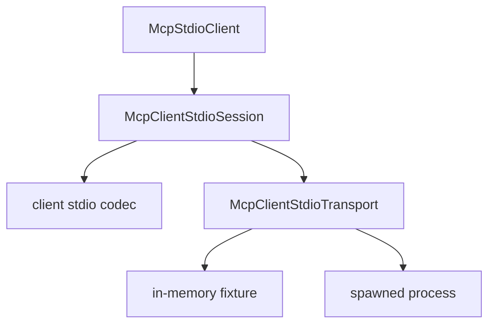

# M43-00 MCP Client Stdio Transport Technical Design Spec

## Purpose

Define the architecture for a client-side MCP stdio transport before implementation begins.

## Product Context

M42 can dispatch server-to-client sampling frames as fixtures, but the runtime still lacks a live client transport for external MCP server processes. This design establishes the next bounded step: a live stdio client for initialize and tools/list.

## Scope

This spec delivers:

- crate ownership and dependency direction
- transport abstraction and process lifecycle boundaries
- JSON-RPC request id and response matching rules
- timeout, EOF, cancellation, and cleanup behavior
- privacy rules for diagnostics

Owned by other specs:

- concrete codec implementation
- in-memory transport runtime
- spawned process implementation
- typed `McpClient` operations
- final docs and quality gates

## Architecture

`agent-mcp` owns all MCP protocol state. A transport trait hides whether frames come from an in-memory fixture or a spawned process. Process-specific code remains behind the same interface.

## Public Contracts

The design should lead to typed contracts for:

- request rendering
- response parsing
- request id allocation
- transport send/receive
- session summary
- redacted transport diagnostics

## State and Failure Handling

- Session states: created, initialized, failed, closed.
- A request is pending from write success until a matching response frame is parsed.
- Notifications are ignored unless a later slice explicitly handles them.
- Unexpected ids, duplicate ids, malformed frames, EOF, timeout, and closed sessions fail deterministically.
- Cleanup can be called multiple times without changing the final close reason.

## Security and Privacy

- Public errors must not include raw child stderr, environment values, prompt text, tool arguments, or secret-like strings.
- Process spawn only uses `McpTransportConfig::Stdio`; HTTP remains later work.
- Secret refs are not resolved in `agent-mcp`.

## Testing Strategy

- design review against existing server stdio and M42 sampling stdio boundaries
- focused tests in later slices
- final CI gate in M43-05

## Acceptance Criteria

- M43 technical design exists and is linked from the milestone index.
- M43 slice specs and plans are ready for implementation.

## Completion Signal

M43-00 is complete when implementers can start M43-01 without re-deciding ownership, lifecycle, or safety boundaries.
