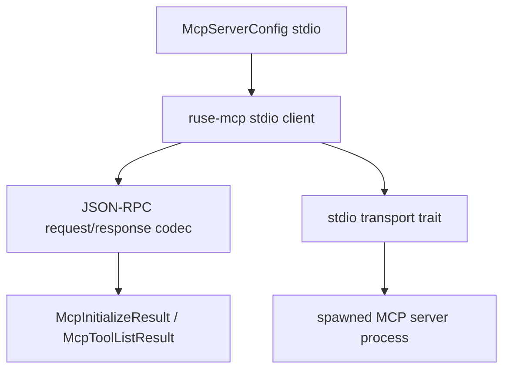

# M43 MCP Client Stdio Transport Runtime Spec

## Purpose

Add a real client-side MCP stdio transport path that can start an external MCP server process, exchange newline-delimited JSON-RPC frames, initialize the server, and list tools through the existing typed `McpClient` boundary.

## Product Context

M31 made `agent` runnable as an MCP stdio server. M40-M42 added safe client-side sampling contracts and fixture-grade sampling frame dispatch. M43 moves the MCP client side from deterministic fixtures toward real external MCP server processes while preserving the same runtime boundary: UI and CLI own presentation, `ruse-mcp` owns MCP protocol behavior, and local policy still controls any local effects.

## Scope

This milestone delivers:

- client-side JSON-RPC frame rendering and response parsing contracts
- deterministic in-memory stdio client session tests
- spawned process stdio transport with bounded line frames, timeout handling, cancellation, and redacted diagnostics
- `McpClient` integration for initialize and tools/list over stdio
- README, milestone status, focused checks, and final quality gate evidence

Owned by later milestones:

- live MCP tools/call execution through gateway policy
- reentrant server-to-client requests while a client request is in flight
- sampling approval UI and Desktop review surfaces
- streamable HTTP MCP client transport
- MCP elicitation, logging, progress, and task utility protocols

## Architecture

`ruse-mcp` owns MCP client stdio protocol state and transport abstractions. A process transport can use `tokio::process` behind an async boundary, but public contracts remain typed and testable with in-memory fixtures. `ruse-cli` may later construct configs and display diagnostics, but it must not implement MCP frame semantics.



## Public Contracts

Expected public contracts:

```rust
pub struct McpClientStdioRequestId(/* opaque */);

pub fn render_mcp_client_stdio_request(
    id: McpJsonRpcId,
    method: impl Into<String>,
    params: serde_json::Value,
) -> Result<String, McpError>;

pub fn parse_mcp_client_stdio_response_frame(
    frame: &str,
) -> Result<McpClientStdioResponse, McpError>;

pub struct McpStdioClient<T> {
    pub transport: T,
}
```

Final names may differ if the implementation discovers a better fit, but the durable shape must keep JSON-RPC IDs, method names, params, success results, and failures typed.

## State and Failure Handling

- Requests receive unique JSON-RPC ids and newline-terminated frames.
- Responses must match the pending request id before they are decoded into typed MCP results.
- Malformed JSON, wrong JSON-RPC version, unexpected ids, server failures, oversized frames, EOF, timeout, and process exit are explicit errors.
- Disabled configs fail before process spawn.
- Process cleanup is best-effort and idempotent.

## Security and Privacy

- External MCP process stdout and stderr are untrusted inputs.
- Public diagnostics are bounded and redacted.
- `ruse-mcp` must not resolve local secret handles directly; callers pass resolved process environment only after policy and secret handling are complete.
- Live stdio client initialization and tool listing do not grant filesystem, command, Git, browser, Desktop, local secret, or local tool permissions.

## Testing Strategy

- codec tests for request rendering, response parsing, ids, errors, and notifications
- deterministic in-memory transport tests for initialize and tools/list
- subprocess tests with a local fixture process
- redaction tests for process errors and malformed frames
- final workspace gate through `cargo xtask ci`

## Acceptance Criteria

- `CARGO_TARGET_DIR=target/codex-m43 cargo test -p ruse-mcp mcp_client_stdio_codec`
- `CARGO_TARGET_DIR=target/codex-m43 cargo test -p ruse-mcp mcp_client_stdio_session`
- `CARGO_TARGET_DIR=target/codex-m43 cargo test -p ruse-mcp mcp_client_stdio_process`
- `CARGO_TARGET_DIR=target/codex-m43 cargo xtask ci`

## Completion Signal

M43 is complete when an external MCP stdio server can be driven through the `ruse-mcp` client runtime for initialize and tools/list, failures are safe and recoverable, docs describe the implemented boundary, and focused plus workspace gates pass.
