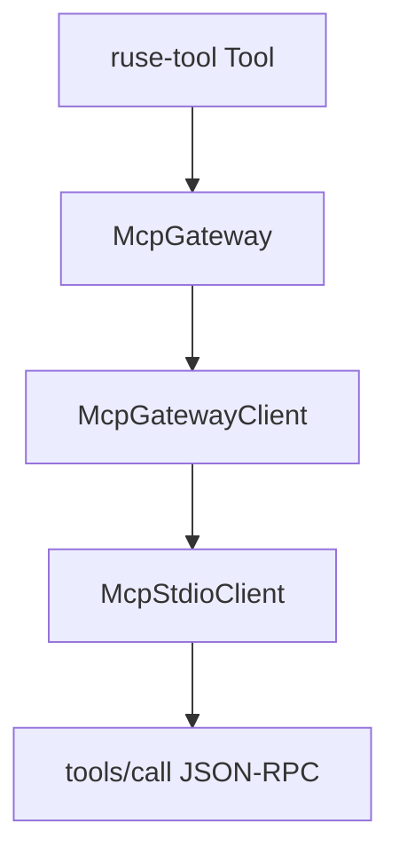

# M44-00 MCP Client Stdio Tool Call Technical Design Spec

## Purpose

Define the implementation boundary for live MCP `tools/call` over client-side stdio sessions.

## Product Context

M43 introduced a live stdio client for initialize and tools/list. M44 extends that same runtime path to execute discovered remote tools through existing typed gateway contracts.

## Scope

This spec delivers:

- crate ownership for `tools/call` mapping
- gateway and policy boundary decisions
- result, error, and redaction behavior
- subprocess E2E verification shape

Owned by other specs:

- implementation of each slice
- final README and quality gate evidence

## Architecture

`ruse-mcp::client_stdio` implements `McpGatewayClient` for `McpStdioClient<T>`. The implementation uses the existing session request path and maps JSON-RPC success results into `McpToolCallResult`.

## Public Contracts

- `McpStdioClient<T>: McpGatewayClient`
- `McpToolCallRequest` is serialized into MCP `tools/call` params.
- `McpToolCallResult` contains the returned remote result JSON.

## State and Failure Handling

- The stdio client must be initialized before a tool call.
- Calls for another server id fail before writing a frame.
- JSON-RPC failure frames return redacted `McpError::Client` values.
- Malformed success payloads return redacted mapping errors.

## Security and Privacy

- Local policy enforcement remains in gateway/local tool execution.
- `ruse-mcp` does not grant filesystem, command, Git, browser, Desktop, or secret access to remote servers.
- Remote success output is data returned by the selected remote tool; diagnostics remain redacted.

## Testing Strategy

- Use fixture transports for exact frame mapping.
- Use process fixtures for live stdio E2E.
- Use gateway tests for local registry integration.

## Acceptance Criteria

- Design creates no new UI crate responsibilities.
- Slice specs and plans are complete enough to implement independently.

## Completion Signal

M44-00 is complete when the milestone and slice documents identify the runtime boundary and verification path.
