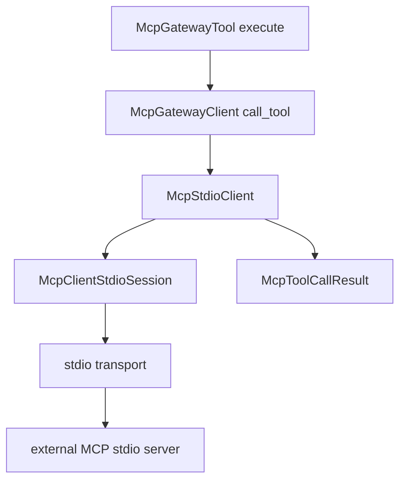

# M44 MCP Client Stdio Tool Call Runtime Spec

## Purpose

Add live MCP `tools/call` execution over the existing client-side stdio runtime so discovered external MCP tools can be invoked through typed `ruse-mcp` contracts and the existing gateway tool path.

## Product Context

M43 can start an external MCP stdio server, initialize it, and list tools. That makes remote tools discoverable but not yet usable. M44 closes that runtime gap by mapping local gateway tool execution into MCP `tools/call` requests while preserving local policy, redaction, output bounding, and UI-agnostic runtime ownership.

## Scope

This milestone delivers:

- `McpStdioClient` support for MCP `tools/call`
- typed mapping from JSON-RPC `tools/call` results into `McpToolCallResult`
- gateway compatibility for live stdio-backed MCP tools
- redacted and bounded diagnostics for remote tool failures and malformed results
- subprocess E2E tests for discover, register, and execute through a live stdio fixture
- README, milestone status, focused checks, and final quality gate evidence

Owned by later milestones:

- reentrant server-to-client requests while a tool call is in flight
- sampling approval UI and Desktop review surfaces
- streamable HTTP MCP client transport
- MCP elicitation, logging, progress, and task utility protocols
- long-running remote tool progress subscriptions

## Architecture

`ruse-mcp` remains the sole owner of MCP client protocol behavior. `McpStdioClient` implements the existing `McpGatewayClient::call_tool` method by serializing one `tools/call` JSON-RPC request over its session and mapping a success result into `McpToolCallResult`. `McpGateway` continues to expose remote tools as local `ruse-tool` tools and continues to bound returned output.



## Public Contracts

Expected public behavior:

```rust
#[async_trait]
impl<T> McpGatewayClient for McpStdioClient<T>
where
    T: McpClientStdioTransport,
{
    async fn call_tool(&self, request: McpToolCallRequest) -> Result<McpToolCallResult, McpError>;
}
```

`McpToolCallRequest` remains the durable local contract:

```rust
pub struct McpToolCallRequest {
    pub server_id: McpServerId,
    pub remote_tool_name: String,
    pub input_json: serde_json::Value,
}
```

## State and Failure Handling

- `call_tool` requires a successful initialize for the same server id.
- Request params are `{"name": remote_tool_name, "arguments": input_json}`.
- Remote JSON-RPC failure frames return bounded public errors without raw remote messages.
- Missing, malformed, or oversized success results are rejected as invalid MCP client stdio tool-call results.
- Stdio transport EOF, timeout, process exit, and mismatched ids reuse the M43 session/process failure paths.
- Gateway output bounding remains local and deterministic.

## Security and Privacy

- Tool descriptors remain discovery metadata, not permission grants.
- Local policy must approve the local gateway tool before a remote `tools/call` is sent.
- Public diagnostics must not expose local tool arguments, remote stderr, process env, secret refs, prompt text, or raw remote failure details.
- Remote success payloads are returned as tool output by design, then bounded by the gateway when surfaced as a local tool result.
- Secret refs continue to be resolved outside `ruse-mcp`.

## Testing Strategy

- fixture transport tests for `McpStdioClient::call_tool` params and result mapping
- fixture transport tests for server mismatch and malformed result redaction
- gateway tests proving live stdio client tools can be discovered, registered, and executed
- subprocess E2E tests with a local MCP stdio helper serving initialize, tools/list, and tools/call
- final workspace gate through `cargo xtask ci`

## Acceptance Criteria

- `CARGO_TARGET_DIR=target/codex-m44 cargo test -p ruse-mcp mcp_client_stdio_tool_call`
- `CARGO_TARGET_DIR=target/codex-m44 cargo test -p ruse-mcp mcp_gateway_stdio_tool_call`
- `CARGO_TARGET_DIR=target/codex-m44 cargo test -p ruse-mcp mcp_client_stdio_tool_call_process`
- `CARGO_TARGET_DIR=target/codex-m44 cargo xtask ci`

## Completion Signal

M44 is complete when a live MCP stdio server can be initialized, listed, registered through the gateway, and called through the local tool registry with safe diagnostics and passing focused plus workspace gates.
