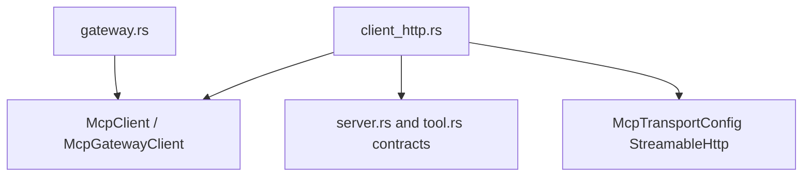

# M45-00 MCP Client Streamable HTTP Technical Design Spec

## Purpose

Define the M45 implementation boundary for MCP client streamable HTTP support before code changes begin.

## Product Context

The runtime can now use stdio MCP servers through discovery and tool calls. HTTP MCP servers need equivalent typed runtime support without moving protocol behavior into CLI/Desktop or weakening local policy boundaries.

## Scope

This spec delivers:

- ownership boundaries for HTTP client code in `agent-mcp`
- request/response contract shape for HTTP JSON-RPC exchanges
- transport abstraction and fixture strategy
- session state and error mapping rules
- slice decomposition for M45 implementation

Owned by other specs:

- concrete codec implementation in M45-01
- concrete transport implementation in M45-02
- discovery mapping in M45-03
- gateway tool calls in M45-04
- README and final gates in M45-05

## Architecture

`agent-mcp` adds an HTTP client module parallel to `client_stdio.rs`. The module should reuse existing server/result contract types where possible: `McpJsonRpcId`, `McpJsonRpcSuccess`, `McpJsonRpcFailure`, `McpInitializeResult`, `McpToolListResult`, and `McpToolCallResult`.



## Public Contracts

M45 should introduce:

```rust
pub struct McpClientHttpRequest {
    pub url: String,
    pub headers: BTreeMap<String, String>,
    pub body_json: serde_json::Value,
    pub timeout_ms: u64,
}

pub struct McpClientHttpResponse {
    pub status: u16,
    pub body_json: serde_json::Value,
}
```

Names may change during implementation, but durable behavior must remain typed and testable.

## State and Failure Handling

- `McpHttpClient` owns the initialized server id and request id counter.
- Initialize records the server id only after typed result mapping succeeds.
- List/call fail before transport if the requested server id is not initialized.
- HTTP transport failures become bounded `McpError::Client` diagnostics.
- Remote JSON-RPC failure messages are not exposed directly.

## Security and Privacy

- Secret refs in headers are rejected until resolved by a caller outside `agent-mcp`.
- Diagnostics redact header names/values and secret-like URL content.
- Request params and tool arguments do not appear in public errors.
- Success payloads are data and may contain remote output by design.

## Testing Strategy

- contract tests for request construction and response parsing
- fixture transport tests for all state transitions
- redaction regression tests
- final `agent-mcp` clippy and workspace CI gates

## Acceptance Criteria

- M45 slice specs and plans exist.
- Milestone index lists M45.
- Active work points at M45-01.

## Completion Signal

M45-00 is complete when the milestone has a concrete slice plan that can be implemented without re-deciding architecture.
