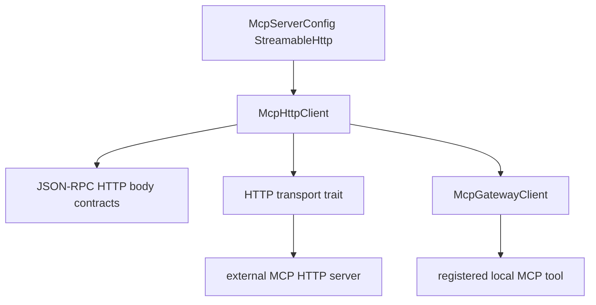

# M45 MCP Client Streamable HTTP Runtime Spec

## Purpose

Add a real client-side MCP streamable HTTP transport path so external HTTP MCP servers can be initialized, listed, and called through the same typed `ruse-mcp` client and gateway contracts used by stdio.

## Product Context

M43 and M44 made external stdio MCP servers executable through `McpStdioClient` and `McpGateway`. The runtime already models `McpTransportConfig::StreamableHttp`, but that configuration is not yet backed by a live client. M45 closes that gap while preserving the core boundary: MCP protocol logic belongs in `ruse-mcp`, local policy gates gateway tool execution, and CLI/Desktop remain presentation layers.

## Scope

This milestone delivers:

- HTTP JSON-RPC request/response body contracts for MCP client calls
- a streamable HTTP transport abstraction with deterministic fixture coverage
- live HTTP client execution for `initialize` and `tools/list`
- gateway-compatible HTTP `tools/call`
- redacted diagnostics for headers, URLs, request bodies, and remote failures
- README, milestone status, focused checks, and final quality gate evidence

Owned by later milestones:

- server-sent event streaming and resumable streams
- reentrant server-to-client callbacks while a request is in flight
- OAuth/DCR authentication and token refresh flows
- MCP elicitation, logging, progress, and task utility protocols
- Desktop MCP server management UX

## Architecture

`ruse-mcp` owns the streamable HTTP client runtime. The initial M45 implementation treats each MCP operation as a request/response JSON-RPC exchange over HTTP POST. The transport layer is abstracted for deterministic tests and can later grow SSE/session behavior without changing gateway contracts.



## Public Contracts

Expected public behavior:

```rust
pub trait McpClientHttpTransport: Send + Sync {
    async fn send_request(
        &self,
        request: McpClientHttpRequest,
    ) -> Result<McpClientHttpResponse, McpError>;
}

pub struct McpHttpClient<T> {
    // owns session state and transport
}
```

`McpHttpClient` must implement:

- `McpClient` for `initialize` and `tools/list`
- `McpClientRootProvider`
- `McpGatewayClient` for `tools/call`

## State and Failure Handling

- Disabled configs fail before transport calls.
- Non-HTTP configs are rejected before transport calls.
- Secret header refs must be resolved outside `ruse-mcp`.
- Requests carry deterministic JSON-RPC ids and method params.
- HTTP non-success statuses, malformed JSON, JSON-RPC failures, mismatched ids, oversized bodies, and timeout/transport failures return typed safe errors.
- Session state requires initialize before list or call for the same server id.

## Security and Privacy

- Header names, header values, URLs with credentials, request params, and remote failure messages are untrusted.
- Public diagnostics are bounded and redacted.
- Tool descriptors remain discovery metadata, not permission grants.
- Local policy gates registered gateway tool execution before any HTTP `tools/call` request is sent.
- Remote success payloads are returned as data by design, then bounded locally by gateway surfaces.

## Testing Strategy

- pure contract tests for JSON-RPC HTTP request rendering and response parsing
- fixture transport tests for initialize/tools/list state and errors
- fixture transport tests for gateway `tools/call`
- redaction tests for headers, URLs, malformed results, remote failures, and transport diagnostics
- final workspace gate through `cargo xtask ci`

## Acceptance Criteria

- `CARGO_TARGET_DIR=target/codex-m45 cargo test -p ruse-mcp mcp_client_http_contracts`
- `CARGO_TARGET_DIR=target/codex-m45 cargo test -p ruse-mcp mcp_client_http_mcp_client`
- `CARGO_TARGET_DIR=target/codex-m45 cargo test -p ruse-mcp mcp_gateway_http_tool_call`
- `CARGO_TARGET_DIR=target/codex-m45 cargo xtask ci`

## Completion Signal

M45 is complete when a streamable HTTP MCP server configuration can be driven through `ruse-mcp` for initialize, tools/list, gateway registration, and tools/call with safe diagnostics and passing focused plus workspace gates.
