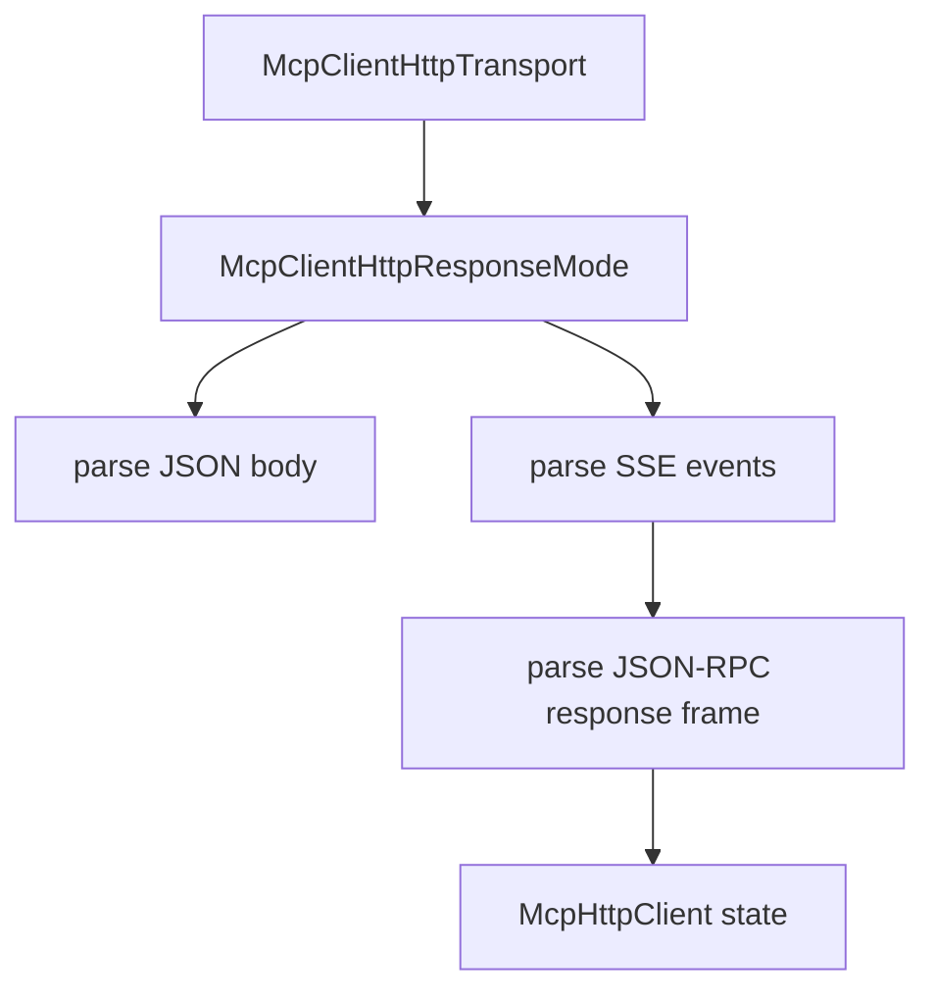

# M46-00 MCP HTTP SSE Response Technical Design Spec

## Purpose

Define the M46 implementation boundary for consuming MCP streamable HTTP SSE response frames before code changes begin.

## Product Context

M45 implemented JSON request/response HTTP calls. Streamable HTTP servers can also answer requests with SSE event streams; the runtime needs a typed, bounded parsing foundation before adding resumability or richer MCP utility protocols.

## Scope

This spec delivers:

- ownership boundaries for SSE response code in `agent-mcp`
- event parsing rules compatible with server-sent event text
- response-mode contracts that preserve existing JSON behavior
- stream bounding and error mapping rules
- slice decomposition for M46 implementation

Owned by other specs:

- concrete SSE event parser in M46-01
- concrete response-mode abstraction in M46-02
- reqwest stream response mapping in M46-03
- client dispatch integration in M46-04
- README and final gates in M46-05

## Architecture

`client_http.rs` remains the owner of HTTP MCP client behavior. M46 should extend the existing `McpClientHttpResponseFrame` parsing path instead of introducing UI-level stream logic.



## Public Contracts

M46 should introduce:

```rust
pub struct McpClientHttpSseEvent {
    pub event: Option<String>,
    pub id: Option<String>,
    pub retry_ms: Option<u64>,
    pub data: String,
}

pub fn parse_mcp_client_http_sse_events(
    body: &str,
) -> Result<Vec<McpClientHttpSseEvent>, McpError>;
```

Names may change during implementation, but contracts must remain typed and fixture-testable.

## State and Failure Handling

- SSE parsing is stateless at M46-01 and bounded at the event/body level.
- M46-02 maps parsed data into existing JSON-RPC response frame contracts.
- M46-03 converts reqwest response headers and body into response mode.
- M46-04 consumes frames through existing request id matching and session state.
- Stream reconnect, event replay, and background stream ownership remain later work.

## Security and Privacy

- Raw event data and malformed bodies are never echoed in diagnostics.
- Secret-like failure messages are redacted after JSON-RPC failure mapping.
- Bounded body/event limits prevent unbounded memory use.
- Local policy remains the only authority for gateway tool execution.

## Testing Strategy

- unit tests for SSE parser behavior
- contract tests for response-mode frame extraction
- transport tests with local HTTP fixture returning `text/event-stream`
- dispatch tests proving matching id selection and safe errors
- final `agent-mcp` clippy and workspace CI gates

## Acceptance Criteria

- M46 slice specs and plans exist.
- Milestone index lists M46.
- Active work points at M46-01.

## Completion Signal

M46-00 is complete when the milestone has a concrete slice plan that can be implemented without re-deciding architecture.
